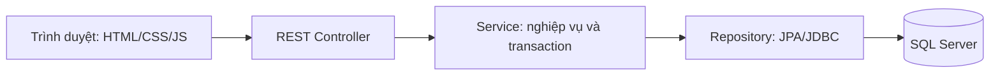

# FC-UTE — Football Field Management Website System

**Hệ thống quản lý và đặt sân bóng · Đồ án Nhóm 19 · Công nghệ phần mềm & Hệ quản trị cơ sở dữ liệu**

Ứng dụng hỗ trợ tra cứu sân trống, đặt sân, nhận/trả sân, dịch vụ, hóa đơn, thu/hoàn tiền và báo cáo. Khách vãng lai xem sân trước khi đăng nhập; các nghiệp vụ được kiểm tra quyền tại backend.

| Thành phần | Lựa chọn của dự án |
|---|---|
| Java | **JDK24**; môi trường phát triển đã dùng 24.0.2 |
| Backend | Spring Boot 3.5.16, Spring Security, Spring Data JPA/JDBC |
| Database | SQL Server; đã nghiệm thu trên SQL Server 2022 Express |
| JDBC | Microsoft SQL Server JDBC 12.8.1.jre11, theo pom.xml |
| Frontend | HTML/CSS/JavaScript, Tailwind CSS, Font Awesome, font cục bộ |
| Build | Maven; đã build bằng Maven 3.10.0 |
| Môi trường hướng dẫn | Windows, PowerShell, VS Code và SSMS |

> **Trước khi cài:** repository có mã nguồn và schema, không có database thật, password hoặc backup dữ liệu. Clone không tự tạo database/login/tài khoản ban đầu. Máy mới cần hoàn thành phần chuẩn bị SQL trước khi chạy web. Push lên GitHub không tự triển khai backend thành website online.

## Mục lục

1. [Giới thiệu](#1-giới-thiệu)
2. [Chức năng theo vai trò](#2-chức-năng-theo-vai-trò)
3. [Kiến trúc](#3-kiến-trúc)
4. [Cài công cụ và tải mã nguồn](#4-cài-công-cụ-và-tải-mã-nguồn)
5. [Chuẩn bị SQL Server](#5-chuẩn-bị-sql-server)
6. [Cấu hình môi trường](#6-cấu-hình-môi-trường)
7. [Build và chạy trong VS Code](#7-build-và-chạy-trong-vs-code)
8. [Đăng nhập và sử dụng](#8-đăng-nhập-và-sử-dụng)
9. [Thanh toán và QR](#9-thanh-toán-và-qr)
10. [DBMS và bảo mật](#10-dbms-và-bảo-mật)
11. [Kiểm thử](#11-kiểm-thử)
12. [Backup và phục hồi](#12-backup-và-phục-hồi)
13. [Cấu trúc và tài liệu](#13-cấu-trúc-và-tài-liệu)
14. [Lỗi thường gặp](#14-lỗi-thường-gặp)
15. [Cập nhật và giới hạn](#15-cập-nhật-và-giới-hạn)

## 1. Giới thiệu

FC-UTE phục vụ quản lý hoạt động sân bóng tại ĐH SPKT TP.HCM. Một ứng dụng Spring Boot phục vụ giao diện và REST API, kết nối SQL Server trực tiếp qua JDBC.

- **CNPM:** vai trò, luồng nghiệp vụ, kiến trúc nhiều lớp, validation, exception, UI/UX và kiểm thử.
- **DBMS:** quan hệ, khóa/ràng buộc, transaction, đồng thời, index, view, SP, function, trigger, SQL roles và backup/restore.

Giao diện ngày **18/10/2026** đã đồng bộ 20 trang. Báo cáo theo ngày ghi kết quả trên môi trường đã thử, không có nghĩa mọi máy clone đã được cấu hình giống máy phát triển.

## 2. Chức năng theo vai trò

Có **4 vai trò đăng nhập** và khu vực công khai cho khách vãng lai.

| Đối tượng | Chức năng |
|---|---|
| Khách vãng lai | Danh mục/tìm sân, tra cứu ngày và khoảng giờ, bản đồ/chỉ đường, đăng ký/đăng nhập |
| Khách hàng — VT01 | Đặt sân, theo dõi xác nhận, lịch đặt/hóa đơn, yêu cầu thanh toán, khuyến mãi, lịch sử/đánh giá, thông tin/phản hồi |
| Nhân viên sân — VT02 | Bảng công việc, lịch tuần, đặt tại quầy, xác nhận/nhận/trả sân, dịch vụ, trạng thái sân, phản hồi và báo cáo sử dụng theo quyền |
| Kế toán — VT03 | Giao dịch/hóa đơn, xác nhận thu theo quyền, hủy/hoàn theo chính sách, doanh thu/phương thức thanh toán/đối soát |
| Chủ sân / Quản lý — VT04 | Tổng quan, lịch, giao dịch, nhân viên/tài khoản/phân quyền, catalog/giá/khuyến mãi, phản hồi, báo cáo, nhật ký và hướng dẫn backup |

Menu phụ thuộc quyền thực tế; ẩn menu không thay kiểm tra role/permission/ownership ở API. Trang backup không cấp quyền backup/restore database cho trình duyệt; quản trị vận hành thực hiện trên máy SQL.

## 3. Kiến trúc



Frontend được Maven đóng gói vào JAR. **Không cần Node server, npm start hoặc VS Code Live Server để chạy web.**

Luồng chính: tra cứu → đăng nhập/đặt → nhân viên xác nhận/nhận sân → dịch vụ/trả sân → hóa đơn/thu/hoàn → lịch sử và báo cáo. Kết quả tra cứu chưa giữ chỗ; backend kiểm lại overlap trong transaction.

Đặt giờ tự do trong **07:00–22:00**, giá theo giờ bắt đầu và phút thực. Lượt legacy giữ giá/thời lượng đã ghi, không tự tính lại theo catalog mới.

## 4. Cài công cụ và tải mã nguồn

### 4.1. Phần mềm cần có

| Công cụ | Nguồn chính thức / mục đích |
|---|---|
| Git | [Cài Git Windows](https://git-scm.com/install/windows) để clone/cập nhật |
| JDK24 | [JDK24 Archive](https://www.oracle.com/java/technologies/javase/jdk24-archive-downloads.html) để tái lập toolchain |
| Maven | [Cài Maven](https://maven.apache.org/install.html) để build/test |
| SQL Server | [Cài Database Engine](https://learn.microsoft.com/en-us/sql/database-engine/install-windows/install-sql-server-from-the-installation-wizard-setup?view=sql-server-ver16) |
| SSMS | [Cài SSMS](https://learn.microsoft.com/en-us/ssms/install/install) để quản trị database |
| VS Code | [VS Code](https://code.visualstudio.com/) để mở source và terminal |

SQL Server và SSMS là hai thành phần khác nhau: chỉ cài SSMS chưa tạo Database Engine. `sqlcmd` dùng cho SQL qua terminal. Node.js/Playwright CLI chỉ cần cho các bài kiểm tra tương ứng, không bắt buộc để chạy JAR.

### 4.2. Chọn JDK24 và Maven

Mở PowerShell mới sau khi cài. Ví dụ cấu hình **terminal hiện tại**; sửa theo thư mục cài thật:

```powershell
$env:JAVA_HOME = 'C:\Program Files\Java\jdk-24'
$env:MAVEN_HOME = 'C:\Tools\apache-maven-3.10.0'
$env:Path = "$env:JAVA_HOME\bin;$env:MAVEN_HOME\bin;$env:Path"

Test-Path "$env:JAVA_HOME\bin\java.exe"
java -version
javac -version
mvn -version
git --version
```

Test-Path phải là `True`; Java trong `mvn -version` phải là **24**. JAVA_HOME trỏ tới thư mục JDK, không tới bin/java.exe. Link archive phục vụ tái lập đồ án; đánh giá vòng đời hỗ trợ JDK riêng trước production, không tự sửa pom.xml để né kiểm tra toolchain.

### 4.3. Clone và mở VS Code

```powershell
git clone https://github.com/minhquan-tool/Football-field-management-website-system.git
cd Football-field-management-website-system
code .
```

Nếu chưa có lệnh `code`, chọn **File → Open Folder**. Trong VS Code mở **Terminal → New Terminal → PowerShell**. Các lệnh tiếp theo chạy từ **thư mục gốc chứa README.md**.

## 5. Chuẩn bị SQL Server

### 5.1. Xác định đúng instance/cổng/database

Cài Database Engine, kết nối SSMS và ghi lại cấu hình thực tế:

| Giá trị | Ý nghĩa |
|---|---|
| `localhost,1433` trong SSMS | SQL TCP trên máy hiện tại, cổng 1433 |
| `localhost\SQLEXPRESS` | Named instance, không mặc định có cổng 1433 |
| `databaseName=QuanLySanBong` | Tên database trong mục Databases của SSMS |
| `SanBongApp` | SQL runtime login, khác database và tài khoản khách web |

Với JDBC TCP, bật TCP/IP cho **đúng instance**, kiểm IPAll/cổng và restart dịch vụ sau thay đổi. Dùng cổng khác thì sửa JDBC tương ứng. Xem [cấu hình TCP/IP](https://learn.microsoft.com/en-us/sql/tools/configuration-manager/tcp-ip-properties-ip-addresses-tab?view=sql-server-ver16).

Runtime dùng SQL authentication riêng; instance cần cho phép chế độ đó. Xem [Mixed Mode](https://learn.microsoft.com/en-us/sql/database-engine/configure-windows/change-server-authentication-mode?view=sql-server-ver16). Không dùng `sa` chạy web.

### 5.2. Đã có database đúng phiên bản

1. Xác nhận schema, catalog và tài khoản ứng dụng đã chuẩn bị.
2. Xác nhận SQL login map đúng database user và quyền nghiệp vụ.
3. Khi restore sang server mới, kiểm login/user mapping; database backup không tự mang theo server login.
4. Chỉ chạy test trên DEV/test đã phân loại, không dùng DB internal cho fixture/cleanup.
5. Không chạy lại toàn bộ migrations: có file proposal, rollback và file cố ý từ chối áp dụng lần hai.

Kiểm tra chỉ đọc trong SSMS của database được chọn:

```sql
SELECT @@SERVERNAME AS ServerName, DB_NAME() AS DatabaseName;
SELECT name, CONVERT(nvarchar(30), value) AS Marker
FROM sys.extended_properties
WHERE class = 0 AND name = N'SanBongEnvironment';
SELECT OBJECT_ID(N'dbo.DatSan') AS DatSan,
       OBJECT_ID(N'dbo.HoaDon') AS HoaDon,
       OBJECT_ID(N'dbo.GiaTheoCa') AS GiaTheoCa;
SELECT COUNT(*) AS ComputedPersistedColumns
FROM sys.computed_columns WHERE is_persisted = 1;
```

Schema hiện hành có 9 computed persisted columns. Đây là kiểm tra sơ bộ, không chứng minh đủ quyền/catalog/ràng buộc.

### 5.3. Máy hoàn toàn mới

**Chưa có installer end-to-end tạo đủ schema, dữ liệu demo, login và tài khoản quản lý bằng một lệnh.** Database rỗng chưa phải môi trường sẵn sàng đăng nhập.

Có hai hướng: chủ dự án cung cấp riêng backup DEV/test được phép chia sẻ và review để restore vào DB/file mới; hoặc DBA tạo schema rồi chuẩn bị catalog, role/permission, runtime user và tài khoản ứng dụng bằng kế hoạch dữ liệu riêng.

Schema-only: [`database/rubric-schema-new-only.sql`](database/rubric-schema-new-only.sql). Lệnh dưới chỉ **minh họa schema rỗng**, dùng tên mới chưa tồn tại:

```powershell
sqlcmd -S tcp:localhost,1433 -E -b -f 65001 -d master `
  -v NewDatabase=SanBong_SchemaDemo_MySetup `
  -i .\database\rubric-schema-new-only.sql
```

Script chỉ chấp nhận tên mới `SanBong_SchemaDemo_...`, từ chối DB đã tồn tại. Không tạo login, quyền runtime, dữ liệu hoặc password quản lý. Không đổi tên DB đang có để vượt guard.

| File / nhóm | Phạm vi |
|---|---|
| `rubric-schema-new-only.sql` | Schema rỗng hiện hành, theo guard tên mới |
| `metadata/current-schema.json` | Định nghĩa schema/module, không có bản ghi người dùng |
| `metadata/normalization-before-schema.json` | Metadata trước chuẩn hóa cho proposal/rollback |
| `schema-bootstrap.sql`, `seed-data.sql` | **Legacy trước nâng cấp**, không nạp seed này trực tiếp trên schema computed |
| `migrations/*.sql` | Review target/trạng thái/điều kiện trước khi áp dụng |
| `*_ROLLBACK.sql` | Quay lại tương ứng, không phải bước cài thông thường |

### 5.4. Quyền runtime

`SanBongApp` là identity SQL của backend; bốn vai trò web vẫn kiểm tra ở Spring Security/Service. Không cấp sysadmin/db_owner/backup cho web. Audit chỉ append/read bằng runtime; SP cần quyền EXECUTE tương ứng.

SQL role minh họa `SB_Customer`, `SB_PitchStaff`, `SB_Accountant`, `SB_Manager` không tạo bốn pool web. User `WITHOUT LOGIN` không có password đăng nhập SSMS.

DBA tham khảo [RuntimeLeastPrivilege](database/migrations/RuntimeLeastPrivilege_20261017.sql) và [hướng dẫn DBMS](docs/DBMS_TECHNICAL_GUIDE.md). Các script có guard, không thay việc tạo/mapping login. DEV/test kiểm quyền dưới **đúng runtime login** bằng `scripts/verify-test-database.sql`, qua sqlcmd hoặc SSMS SQLCMD Mode; không đặt password trong dòng lệnh.

## 6. Cấu hình môi trường

### 6.1. Tạo file riêng

```powershell
if (-not (Test-Path .env.test.local)) {
    Copy-Item .env.test.example .env.test.local
}
notepad .env.test.local
```

Điền giá trị thật trên máy; không ghi password vào application.yml/Java:

```dotenv
JAVA_HOME=C:\Program Files\Java\jdk-24
APP_ENV=test
SAN_BONG_TEST_MODE=test
APP_HOST=127.0.0.1
APP_PORT=8082
APP_CONTEXT_PATH=/api
APP_DB_URL=jdbc:sqlserver://localhost:1433;databaseName=QuanLySanBong;encrypt=true;trustServerCertificate=false
APP_DB_USER=SanBongApp
APP_DB_PASSWORD=fill_privately
APP_MIGRATE_LEGACY_PASSWORDS=false
AUTH_TEST_BASE_URL=http://127.0.0.1:8082/api
SQLCMD_TEST_SERVER=tcp:localhost,1433
SQLCMD_TEST_DATABASE=QuanLySanBong
AUTH_TEST_PASSWORD=fill_privately
```

Trong dotenv không thêm `export`, `$env:` hoặc dấu ngoặc kép quanh giá trị. Điền database có thật, không tạo DB trống cùng tên chỉ để vượt lỗi cấu hình.

### 6.2. Ý nghĩa các biến

| Biến | Ý nghĩa |
|---|---|
| `JAVA_HOME` | JDK24 trên máy hiện tại |
| `APP_DB_URL` | JDBC host/cổng/database, không nhúng password |
| `APP_DB_USER` / `APP_DB_PASSWORD` | SQL runtime credential, khác tài khoản khách web |
| `APP_HOST` | 127.0.0.1 cho local; 0.0.0.0 khi triển khai nhiều giao diện đã review |
| `APP_PORT` | Mẫu 8082; application.yml mặc định 8080 nếu không đặt |
| `APP_CONTEXT_PATH` | Tiền tố URL, mẫu /api |
| `APP_ENV` | dev, test hoặc internal |
| `SAN_BONG_TEST_MODE` | Opt-in, vẫn cần marker/identity đúng; không tự biến DB thành test |
| `AUTH_TEST_PASSWORD` | Credential web cho test, khác SQL password; không cần để chỉ package/start |
| `SQLCMD_TEST_SERVER` / `SQLCMD_TEST_DATABASE` | Target công cụ test, phải khớp môi trường review |
| `APP_MIGRATE_LEGACY_PASSWORDS` | Giữ false nếu không có kế hoạch chuyển plaintext riêng |
| `APP_LOG_FILE` | Nơi ghi log tùy chọn, ngoài static/public |
| `APP_SECURE_COOKIE` | Theo HTTPS thực tế; HTTP local theo mẫu không bật |

Private env và deploy.env được ignore; các file `.example` là mẫu công khai. Bộ test có login cần AUTH_TEST_PASSWORD và các account được chuẩn bị đúng, không để giá trị placeholder rồi kỳ vọng test đạt.

### 6.3. TLS SQL

Mẫu dùng `encrypt=true;trustServerCertificate=false`: cần certificate/trust phù hợp hostname SQL. Xem [kết nối SSMS](https://learn.microsoft.com/en-us/ssms/quickstarts/ssms-connect). Lỗi certificate cần sửa certificate/trust chain, không reset DB hoặc bỏ schema validation. Tin certificate tự ký cho DEV là quyết định quản trị riêng, không dùng mặc định đó cho Internet production.

## 7. Build và chạy trong VS Code

### 7.1. Build khi chưa chạy integration test

Sau khi chọn JDK24/Maven ở mục 4:

```powershell
mvn -B -f .\backend\pom.xml "-Dmaven.test.skip=true" package
```

Lệnh này **bỏ qua test**, không chứng minh DB/API hoạt động. Lần đầu cần mạng để tải dependencies; chỉ thêm `-o` khi cache Maven đã đủ. JAR được tạo tại:

```text
backend/target/san-bong-backend-1.0.0.jar
```

Không build/ghi đè JAR trong lúc server đang dùng nó; cập nhật bản đang vận hành cần candidate/khoảng dừng riêng.

### 7.2. Terminal thứ nhất: chạy backend

Sau khi database và file cấu hình đã sẵn sàng:

```powershell
.\backend\manage-backend.ps1 -Action run -EnvFile .\.env.test.local
```

Chờ `Started SanBongApplication` và Tomcat chạy trên cổng đã chọn. Terminal tiếp tục bận vì đang phục vụ web, không phải bị đơ. Dùng **Ctrl+C** khi cần dừng, sau khi kết thúc các thao tác ghi đang diễn ra.

### 7.3. Terminal thứ hai: mở trình duyệt

```powershell
Start-Process "http://127.0.0.1:8082/api/"
```

| Màn hình | URL mẫu |
|---|---|
| Trang công khai mặc định | `http://127.0.0.1:8082/api/` |
| Trang chủ trực tiếp | `http://127.0.0.1:8082/api/Trang_chu.html` |
| Đăng nhập | `http://127.0.0.1:8082/api/Dang_nhap.html` |
| Đăng ký khách hàng | `http://127.0.0.1:8082/api/Dang_ky.html` |
| Health ứng dụng/database | `http://127.0.0.1:8082/api/health` |

Dùng đúng http/https, host/cổng/context đã cấu hình. Không mở HTML bằng file:// hoặc Live Server để thay Spring Boot: API/cookie/CSRF phải đi qua server đúng cấu hình.

```powershell
Test-NetConnection 127.0.0.1 -Port 8082
Invoke-RestMethod "http://127.0.0.1:8082/api/health"
```

Health đạt có `status: UP`, `database: UP`. Mở trình duyệt không tự chạy server. Sau khi tắt máy, cần SQL service và backend chạy lại nếu chưa cấu hình autostart riêng.

### 7.4. Launcher quản lý tiến trình

Muốn chạy nền bằng công cụ dự án, dùng cách này **thay cho** mục 7.2:

```powershell
.\scripts\server.ps1 -Action start -EnvFile .\.env.test.local

# Sau khi kết thúc thao tác ghi, dừng server do launcher này quản lý:
.\scripts\server.ps1 -Action stop
```

Launcher kiểm cổng, identity tiến trình, health và log; không tự nhận một Java process mở bằng cách khác. Không mở hai server cùng cổng hoặc kill mọi java.exe để giải quyết xung đột.

### 7.5. Build kèm test runtime

Khi có DEV/test đúng quyền, dữ liệu và credential cho test:

```powershell
.\backend\manage-backend.ps1 -Action build -EnvFile .\.env.test.local
```

Khác mục 7.1, lệnh này chạy suite runtime đã chọn. Không dùng để thử fixture trên DB vận hành hoặc nâng quyền runtime lên DBA để test đi qua.

## 8. Đăng nhập và sử dụng

Tài khoản SQL trong dotenv chỉ kết nối backend với database. Người dùng web đăng nhập bằng TaiKhoan được liên kết đúng vai trò.

- Khách mới dùng **Đăng ký** khi dữ liệu/permission nền đã chuẩn bị.
- Nhân viên/kế toán/quản lý dùng tài khoản do quản trị ứng dụng cấp.
- Test có các tên demo `khachhang`, `nvsan`, `ketoan`, `admin`; clone không tự tạo chúng. Không coi credential demo là tài khoản vận hành dùng chung.
- Password lưu dạng hash; không lấy hash trong SSMS để nhập vào form, không thể SELECT để đọc ngược plaintext.

Kịch bản demo: khách tra cứu → đăng nhập/đặt → nhân viên xác nhận/nhận/trả và dịch vụ → kế toán xử lý thu/hoàn → quản lý xem báo cáo. Khi thử nhiều vai trò, dùng các phiên/cửa sổ riêng để tránh dùng chung cookie.

Xem [demo bốn vai trò](docs/DEMO_4_VAI_TRO.md); tài liệu cũ cần đối chiếu code hiện hành trước khi làm theo.

## 9. Thanh toán và QR

| Trường hợp | Hành vi |
|---|---|
| Tiền mặt | Theo luồng chờ/xác nhận; khách không tự xác nhận đã thu |
| Chuyển khoản | Hướng dẫn/ảnh QR cấu hình riêng; nhân sự có quyền kiểm tra/xác nhận |
| Khuyến mãi | Backend kiểm điều kiện và tính giảm, không tin tiền do trình duyệt gửi |
| Dịch vụ thêm | Gắn vào lượt đặt/hóa đơn theo quyền, thời điểm và trạng thái |
| Hủy/hoàn | Theo chính sách thời gian và thực thu, không sửa/xóa khoản đã thu để bù trừ |

VIP10 trong chính sách đã chốt áp dụng **thứ Tư**, ngoài các điều kiện khác. Giá/khuyến mãi thực tế phải xem cấu hình database.

Phương án hiện hành dùng ảnh QR xuất từ ứng dụng ngân hàng, không gọi dịch vụ tạo ảnh VietQR bên ngoài. Điền riêng:

```dotenv
APP_BANK_TRANSFER_ENABLED=false
APP_BANK_BIN=
APP_BANK_NAME=
APP_BANK_ACCOUNT_NUMBER=
APP_BANK_ACCOUNT_NAME=
APP_BANK_QR_FILE=
```

Chỉ bật sau khi chủ tài khoản kiểm tra thông tin/ảnh và restart backend. Đặt ảnh private trong run/ với quyền đọc phù hợp, không đặt trong static/public. Quét QR/chuyển tiền **không tự xác nhận** khoản thu; chưa có webhook ngân hàng tự động trong luồng này.

## 10. DBMS và bảo mật

Theo metadata hiện hành: **27 bảng nghiệp vụ, 9 view, 6 function, 5 SP báo cáo, 5 trigger nghiệp vụ và 9 computed persisted columns**. Không tính tiện ích diagram SSMS vào đối tượng nghiệp vụ.

| Kỹ thuật | Áp dụng |
|---|---|
| PK/FK/UNIQUE/CHECK | Danh tính, tham chiếu và tính hợp lệ |
| FD/chuẩn hóa | Công bố giả định và phân biệt thuộc tính cơ sở/dẫn xuất |
| Snapshot | Giữ giá bán, tiền/thời lượng legacy và hóa đơn chốt khi catalog đổi |
| Computed persisted | SQL tính 9 cột, JPA/JDBC không ghi trực tiếp |
| Trigger | Tổng dịch vụ và bất biến audit, snapshot, khoản đã thu, hóa đơn chốt |
| Transaction/khóa | San → DatSan, chống overlap và nhất quán dịch vụ/tài chính |
| Idempotency | Bảo vệ thao tác thu/hoàn lặp theo cơ chế nghiệp vụ |
| View/SP/UDF | Tra cứu và báo cáo với nghĩa tiền/công suất tách rõ |
| Index | Hỗ trợ truy vấn; benchmark ở tài liệu kỹ thuật riêng |
| SQL roles | Runtime giới hạn quyền và bốn role minh họa |
| Backup/restore | COPY_ONLY/CHECKSUM/VERIFYONLY, hash và restore drill riêng |

Không tuyên bố toàn schema vật lý đạt “3NF tuyệt đối”: còn snapshot, computed persisted và tổng liên bảng lưu có kiểm soát. Xem [mô hình FD](docs/DBMS_NORMALIZATION_MODEL.md).

Ba số liệu khác nhau: **doanh thu phát sinh** tại ngày trả sân/snapshot hóa đơn; **thu gộp** trước hoàn; **thực nhận ròng** là thu trừ hoàn xác nhận. V_DoanhThuTheoNgay giữ tên legacy và là alias tiền thu gộp, không phải tiền ròng. Công suất theo phút dùng 07–22h và danh mục hiện tại, chưa có lịch sử bảo trì đầy đủ để gọi là công suất khả dụng lịch sử tuyệt đối.

Bảo mật ứng dụng: BCrypt, session cookie HttpOnly/SameSite, CSRF, giới hạn login, validation, role/permission/ownership backend và secrets qua môi trường. Không báo thành công khi database thất bại. SQL DBA vẫn có quyền quản trị DDL; không gọi nhật ký là kho chống sửa tuyệt đối với DBA.

## 11. Kiểm thử

### 11.1. Chọn đúng suite

| Nhóm | Điều kiện |
|---|---|
| Package bỏ test | JDK24/Maven, không kiểm DB/API |
| Runtime | DEV/test có marker, SanBongApp đúng quyền và dữ liệu/credential |
| Fixture/commit/concurrency | Database/login fixture riêng, marker/opt-in đúng |
| Browser | Backend chạy, Playwright CLI và account test tương ứng |
| DBMS offline | Python 3, metadata schema; không kết nối SQL |

```powershell
# Runtime:
.\backend\run-verification.ps1 -Suite runtime -EnvFile .\.env.test.local

# CHỈ trên database fixture riêng đã chuẩn bị:
.\backend\run-normalization-verification.ps1 `
  -EnvFile .\.env.fixture.local -IncludeLegacyViews

# FD/chuẩn hóa từ metadata, không chạy SQL:
python .\scripts\verify-normalization-model.py
```

Không tự chạy toàn bộ mvn test bằng profile web chưa phân loại suite; không fixture/cleanup trên DB internal hoặc cấp DELETE audit cho runtime. `-Offline`/`-o` chỉ dùng khi Maven cache đủ.

[prepare-disposable-fixtures.ps1](scripts/prepare-disposable-fixtures.ps1) nhận backup/layout/marker được review, tên DB/login mới và tạo profile riêng; không phải installer dữ liệu từ đầu hoặc restore đè DB.

### 11.2. Kết quả đã ghi nhận

UI/UX đã đồng bộ 20 HTML; kiểm tra 27 lượt trang theo menu bốn vai trò ở 375/390/768/1024/1440px và kiểm biểu mẫu. Không có pageerror trong lượt đó. Đây là browser desktop/viewport giả lập, không chứng nhận mọi iPhone/Safari thật.

Đợt DBMS ghi nhận 205 kiểm thử chuẩn hóa, 130 runtime và 37 view/hồi quy. Các bộ có phần trùng, **không cộng thành tổng số test độc lập**. Xem [nghiệm thu DBMS](docs/DBMS_NORMALIZATION_VIEWS_BACKUP_2026-10-18.md) và [nghiệm thu UI](docs/UI_UX_REDESIGN_2026-10-18.md). Log/screenshot có dữ liệu được giữ riêng, không có đầy đủ trong bản public.

## 12. Backup và phục hồi

Chạy trên **máy SQL** bằng Windows identity được phép, không nâng quyền backup cho SanBongApp. Đọc script và kiểm đúng instance/thư mục trước khi dùng:

```powershell
if (-not (Test-Path .\run)) { New-Item -ItemType Directory .\run | Out-Null }

# Lần chuẩn bị thư mục mới; script từ chối thư mục đã tồn tại:
.\scripts\prepare-backup-directory.ps1

# Một lượt backup + kiểm tra:
.\scripts\backup-database.ps1 -BackupDirectory (Join-Path $PWD 'run/backups')

# Xem kế hoạch, chưa đăng ký task:
.\scripts\register-backup-task.ps1 -Interactive -AtTime 02:00 `
  -BackupDirectory (Join-Path $PWD 'run/backups') -WhatIf
```

Helper hiện dùng **QuanLySanBong**, mặc định localhost:1433; không coi là tự hỗ trợ mọi tên DB/instance. Cần quyền SQL/OS phù hợp, không lưu password trong task.

Sau khi quản trị duyệt kế hoạch, bỏ -WhatIf để đăng ký task mới; script không ghi đè task cũ. Kiểm tra:

```powershell
Get-ScheduledTask -TaskName SanBongSqlBackup
Get-ScheduledTaskInfo -TaskName SanBongSqlBackup
Start-ScheduledTask -TaskName SanBongSqlBackup
```

- Interactive cần tài khoản Windows đăng nhập; StartWhenAvailable chạy bù khi đủ điều kiện. Máy tắt không chạy backup.
- Clone không tự cài task; lịch đã nghiệm thu trên máy phát triển không tự xuất hiện trên máy khác.
- Biên nhận: run/backup-receipts; transcript: run/backup-task-logs.
- KeepDays chỉ làm retention khi thêm -Prune; mặc định chưa tự xóa, cần review quyền/hash/chính sách trước khi bật.
- VERIFYONLY không thay restore drill. Restore vào tên/file mới, CHECKDB, đối chiếu dữ liệu và JPA validate; không WITH REPLACE/DROP/restore đè DB đang có.
- Backup cùng máy chưa chống mất/hỏng cả máy; kho ngoài máy là cấu hình riêng.

Xem [backup/restore](docs/BACKUP_RESTORE_GUIDE.md) và [cập nhật mới](docs/DBMS_NORMALIZATION_VIEWS_BACKUP_2026-10-18.md).

## 13. Cấu trúc và tài liệu

```text
Football-field-management-website-system/
├── backend/
│   ├── pom.xml
│   ├── manage-backend.ps1
│   ├── run-verification.ps1
│   ├── run-normalization-verification.ps1
│   ├── src/main/java/com/sanbong/
│   │   ├── controller/       # REST request/response
│   │   ├── service/          # Nghiệp vụ, validation, transaction
│   │   ├── repository/       # JPA/JDBC và SQL/SP
│   │   └── model/            # Entity và schema mapping
│   ├── src/main/resources/   # Cấu hình qua biến môi trường
│   ├── src/test/             # Kiểm thử Java
│   └── scripts/              # Browser/SQL checks
├── frontend/
│   ├── *.html                # 20 trang, shell theo vai trò
│   ├── css/                  # Tailwind/shared/public/schedule
│   ├── js/                   # Module API/UI
│   ├── assets/               # Logo và minh họa cục bộ
│   └── vendor/               # Font/icon, license tương ứng
├── database/
│   ├── migrations/           # Migration/proposal/rollback
│   ├── metadata/             # Định nghĩa schema/module
│   ├── rubric-schema-new-only.sql
│   └── *.sql                 # Probe/benchmark/transaction/legacy
├── scripts/                  # Toolchain/server/backup/tooling
├── docs/                     # Hướng dẫn và bàn giao kỹ thuật
├── design-system/fc-ute/      # Quy tắc UI/UX
├── .env.example
├── .env.test.example
├── deploy.env.example
├── .gitignore
├── .gitattributes
└── README.md
```

Target, run, logs, exports, releases, private env, backup và snapshot trình duyệt được ignore. Chúng có thể được tạo sau build/test/vận hành, không phải clone bị thiếu file.

| Tài liệu | Nội dung |
|---|---|
| [Backend README](backend/README.md) | Backend và lịch sử triển khai |
| [Môi trường test](docs/TEST_ENVIRONMENT_SETUP.md) | Runtime/fixture, marker/identity |
| [Từ điển schema](docs/DBMS_SCHEMA_DICTIONARY.md) | Cột/khóa/ràng buộc/ERD |
| [Hướng dẫn DBMS](docs/DBMS_TECHNICAL_GUIDE.md) | SP/view/trigger/quyền/demo SQL |
| [FD và chuẩn hóa](docs/DBMS_NORMALIZATION_MODEL.md) | Phụ thuộc hàm/snapshot/giới hạn |
| [Chuẩn hóa/view/backup](docs/DBMS_NORMALIZATION_VIEWS_BACKUP_2026-10-18.md) | Thay đổi và nghiệm thu |
| [Bàn giao UI](docs/UI_UX_REDESIGN_2026-10-18.md) | Giao diện và browser checks |
| [Design system](design-system/fc-ute/MASTER.md) | Màu/chữ/layout/focus/responsive |

Tài liệu phase/ngày cũ là lịch sử, có thể còn cổng/schema trước nâng cấp; đối chiếu code và bàn giao mới khi có khác biệt.

## 14. Lỗi thường gặp

| Hiện tượng | Kiểm tra / xử lý |
|---|---|
| 127.0.0.1 từ chối kết nối | Backend chưa listen, đã dừng hoặc sai cổng; chạy lại, chờ startup thành công, kiểm Test-NetConnection và /health |
| Tắt máy rồi mở link không được | URL không tự chạy server; kiểm SQL service và khởi động backend |
| Mở trang đăng nhập thay trang chủ | Dùng /api/ hoặc /api/Trang_chu.html; /Dang_nhap.html là trang đăng nhập |
| Java executable does not exist / Test-Path=False | Sửa JAVA_HOME đến JDK thật, kiểm bin/java.exe |
| release version 24 not supported | Maven dùng JDK khác; sửa JAVA_HOME/PATH và kiểm mvn -version |
| mvn không nhận diện | Thêm Maven/bin vào PATH hoặc dùng đường dẫn mvn.cmd thật, kiểm MAVEN_HOME |
| .test.skip=true bị coi là lifecycle phase | Quote tham số PowerShell: "-Dmaven.test.skip=true" |
| APP_DB_USER still contains a template placeholder | Env còn giá trị mẫu; điền runtime login thật, chọn đúng -EnvFile |
| SQL login failed | Kiểm instance, Mixed Mode, login enabled, password, database/user mapping và quyền CONNECT |
| Unable to determine Dialect / JDBC metadata | Đọc lỗi SQL phía trên: URL/TCP/cổng/login/certificate/database; không chỉ thêm dialect che lỗi kết nối |
| Schema validation thiếu/sai cột | Review schema/migration đúng phiên bản, không đổi ddl-auto thành update/create |
| Cannot update computed column | Seed/SQL/JAR cũ ghi cột dẫn xuất; dùng code/schema cùng phiên bản, không xóa computed để né lỗi |
| Port 8082 already occupied | Xác định tiến trình đang dùng; không mở thêm backend hoặc kill Java không rõ chủ |
| Terminal đứng sau Started... | Backend đang phục vụ; mở terminal thứ hai cho trình duyệt |
| Đăng ký báo dữ liệu không hợp lệ | Xem từng trường/response API, không dùng tài khoản SQL trong form web |
| HTTP 401/403 | Kiểm session/CSRF/role/permission; không bỏ phân quyền để vào màn hình trái vai trò |
| Bản đồ không tải | Kiểm mạng và dùng nút mở Google Maps; bản đồ ngoài cần mạng |
| Giao diện còn bản cũ | Ctrl+F5; sửa source rồi phải build/restart đúng JAR, không giữ JAR cũ |
| Test lỗi khi thêm Offline | Cache chưa đủ; bỏ Offline cho lần tải đầu |
| PowerShell chặn script | Xem execution policy; sau khi tin cậy source có thể dùng Set-ExecutionPolicy -Scope Process Bypass cho terminal đó; policy tổ chức do quản trị xử lý |
| Điện thoại/máy khác không vào 127.0.0.1 | Địa chỉ trỏ về chính thiết bị đó; cần IP/host hoặc HTTPS tunnel server đã cấu hình/nghiệm thu |
| Có task backup nhưng không có BAK mới | Kiểm LastTaskResult, phiên đăng nhập, quyền SQL/OS, thư mục và transcript; Registered chưa chứng minh backup thành công |

Kiểm cổng chỉ đọc:

```powershell
Get-NetTCPConnection -LocalPort 8082 -State Listen
```

Xem log startup/application của cách chạy đã chọn. Khi nhờ hỗ trợ chỉ gửi lỗi cần thiết, không đăng profile/cookie/password hoặc dữ liệu khách hàng.

## 15. Cập nhật và giới hạn

### Cập nhật bằng Git

Khi không có thay đổi local cần giữ riêng:

```powershell
git status
git pull --ff-only
```

Đưa thay đổi đã review lên repository có quyền ghi:

```powershell
git status
git add README.md
git commit -m "Update project documentation"
git push origin main
```

Stage từng file đã kiểm tra. Không force-push để bỏ qua xung đột, không commit private env/backup/ảnh có thông tin cá nhân. Giữ license/thông báo bản quyền vendor; công khai repository không thay quyền phát hành thành phần hoặc dữ liệu của nhóm.

### Giới hạn còn lại

- Chưa có installer đầy đủ cho database rỗng; cần dữ liệu/tài khoản/quyền như mục 5.
- Chưa có CI tự chạy mọi integration trên GitHub; nhiều test cần SQL DEV/test riêng.
- QR chưa tích hợp webhook/sao kê ngân hàng tự động.
- Backup ngoài máy, chế độ chưa đăng nhập và retention cần cấu hình riêng.
- Chưa có đủ lịch sử bảo trì/ngừng sân để tính công suất khả dụng lịch sử tuyệt đối.
- UI kiểm bằng browser desktop/viewport giả lập, chưa bao phủ mọi thiết bị thật.
- Helper PowerShell phục vụ Windows; vận hành đa nền tảng chưa được nghiệm thu.
- Chưa chứng nhận Internet production; LAN/ở xa cần cấu hình server/HTTPS/cookie/proxy và kiểm từ client thật.

**Repository:** [minhquan-tool/Football-field-management-website-system](https://github.com/minhquan-tool/Football-field-management-website-system)
