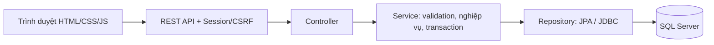

# BÁO CÁO CUỐI KỲ: HỆ THỐNG QUẢN LÝ SÂN BÓNG SAN_BONG

> Cập nhật 13/10/2026: bản sửa R01/R02/R04/R05 đã có kiểm chứng policy/unit/browser theo phạm vi. Chi tiết tại `FIX_PACKAGE_A_2026-10-13.md` và `FIX_PACKAGE_B_FINANCE_2026-10-13.md`; chưa chứng nhận full DB integration/runtime/release. Các bảng audit trong báo cáo giữ mốc12/10 để truy vết.

**Áp dụng cho:** Công nghệ phần mềm và Hệ quản trị cơ sở dữ liệu.  
**Ngày tổng hợp:** 12/10/2026.  
**Phạm vi:** kết quả triển khai, đánh giá kỹ thuật, danh sách cần sửa, kiểm thử nghiệm thu và hướng phát triển sản phẩm nội bộ.

Thông tin lớp, giảng viên, thành viên và phân công cần bổ sung theo hồ sơ thật của nhóm. Báo cáo này không thay thế rubric riêng của từng môn; các mục cần ERD/use case và bằng chứng còn thiếu được đánh dấu ở phần hồ sơ nộp.

## 1. Tóm tắt kết quả và khả năng sử dụng

San_Bong là ứng dụng quản lý sân bóng cho khách hàng, nhân viên sân, kế toán và quản trị viên. Hệ thống sử dụng HTML/CSS/JavaScript, REST API, Java Spring Boot, JPA/JDBC và SQL Server; frontend được đóng gói cùng backend. Một server phục vụ các trình duyệt nhân viên là mục tiêu vận hành.

Các luồng chính đã có trong mã: đăng ký/đăng nhập/phân quyền; quản lý sân; tra cứu và đặt giờ tự do; tạo khách tại quầy; xác nhận/hủy; nhận/trả sân; dịch vụ; hóa đơn snapshot; ghi nhận thanh toán nhiều lần; hoàn theo thực thu; quản trị nhân viên/tài khoản/permission; báo cáo doanh thu và dòng tiền.

**Kết luận:** nền tảng phù hợp để hoàn thiện thành sản phẩm nội bộ, nhưng source mới nhất chưa qua đầy đủ regression/runtime/release và nghiệm thu vận hành. Chưa nên tuyên bố sẵn sàng dùng tiền thật hoặc vận hành hằng ngày. Không cần tạo lại project hay đổi stack.

| Mức sử dụng | Đánh giá tại thời điểm báo cáo |
|---|---|
| Trình bày thiết kế/mã nguồn đồ án | Có đủ nội dung kỹ thuật để trình bày, cần hoàn thiện hồ sơ/bằng chứng theo rubric |
| Demo live | Có bằng chứng E2E lịch sử; phải chuẩn bị và kiểm tra lại DEV candidate trước buổi demo. Probe12/10 tại8080/8082 không nhận kết nối |
| Pilot nội bộ với dữ liệu thật | Chưa đạt: cần hoàn tất nhóm bắt buộc và nghiệm thu phù hợp |
| Vận hành hằng ngày | Chưa đạt: thiếu chứng nhận release mới, vận hành/backup/client thật và một số sửa lỗi UX |
| Công khai Internet | Ngoài phạm vi đã giao; không có chứng nhận cho mục tiêu này |

## 2. Nghiệp vụ và yêu cầu nền tảng

### 2.1. Các vai trò

| Vai trò | Nghiệp vụ chính |
|---|---|
| Khách hàng | Đăng ký, xem sân trống, đặt sân của mình, dịch vụ đặt trước, xem hóa đơn, gửi yêu cầu thanh toán, hủy và xem hoàn |
| Nhân viên sân | Tạo khách tại quầy, đặt/xác nhận, nhận/trả sân, dịch vụ phát sinh, thao tác thu theo permission |
| Kế toán | Kiểm tra giao dịch, xác nhận thực thu/hoàn, đối soát và báo cáo tài chính |
| Quản trị | Quản lý sân/catalog/nhân viên/tài khoản/permission, nhật ký và báo cáo |

Role và permission được kiểm tra ở backend; khách chỉ được truy cập booking/tài chính của mình. UI ẩn nút không thay thế phân quyền API.

### 2.2. Quy tắc nghiệp vụ quan trọng

- Booking mới trong 07:00–22:00, chính xác theo phút. Giá giờ lấy theo **giờ bắt đầu** từ GiaTheoCa; tiền sân = đơn giá × số phút/60.
- Booking legacy giữ MaKhungGio, CheDoGia=GIA_KHUNG và tiền lịch sử. Không tính lại lịch sử bằng chính sách mới.
- Dịch vụ có nguồn đặt trước/phát sinh, quy cách đơn vị/lốc 6 giảm3%, snapshot giá; chỉnh dòng bằng MaChiTiet. Trigger là nguồn cập nhật tổng dịch vụ.
- Một hóa đơn cho mỗi booking; chốt snapshot khi trả sân. Thanh toán nội bộ có thể nhiều lần và có idempotency.
- Hủy áp tỷ lệ100% trước/đúng mốc 10 giờ,50% trước/đúng mốc 2 giờ,0% sau đó; tính hoàn theo thực thu. Yêu cầu chờ xử lý chưa phải tiền đã thu; yêu cầu hoàn chưa xác nhận chưa phải tiền đã hoàn.
- Doanh thu ghi nhận tại trả sân, thực nhận = thu thành công − hoàn đã xác nhận. Không tự chuyển tiền ngân hàng.
- Mọi ghi dịch vụ/tài chính giữ transaction và thứ tự khóa San → DatSan. Không chỉ dựa vào unique index để chống interval overlap.

### 2.3. Yêu cầu phi chức năng

Không báo thành công khi ghi API/DB thất bại; xử lý lỗi rõ; bảo vệ mật khẩu/secret; giữ lịch sử; build tái lập; phục hồi an toàn; cấu hình được host/port/database. Fixture/cleanup chỉ trên dev/test được đánh dấu và opt-in. Không restore đè database hiện có.

## 3. Nội dung đánh giá cho môn Công nghệ phần mềm

### 3.1. Kiến trúc hiện tại

Controller tiếp nhận request và kiểm quyền; Service thực hiện nghiệp vụ/ownership/transaction; Repository truy cập dữ liệu bằng tham số bind/JPA. Đây là cấu trúc một ứng dụng triển khai tập trung, phù hợp phạm vi sân bóng nội bộ.

### 3.2. Cấu trúc thư mục dự án San_Bong

Cây thư mục theo tên thực tế và chức năng từng thành phần được trình bày tại [Cấu trúc thư mục dự án San_Bong](CAU_TRUC_THU_MUC_SAN_BONG.md). Các nhóm chính gồm `frontend/` (frontend), `backend/` (backend), `database/` (SQL Server), `scripts/` (vận hành) và `docs/` (hồ sơ đồ án). Cây mô tả không đổi tên file/URL đang được ứng dụng sử dụng.

### 3.3. Điểm đã thực hiện

- Phát triển theo phase, có báo cáo thay đổi/kiểm thử và giữ UI/code cũ khi phù hợp.
- Backend authentication, session, CSRF, role/permission, password hash; phiên bị vô hiệu khi account khóa/reset.
- DTO/validation, exception handler, mã HTTP400/401/403/404/409/503; không trả password entity cho frontend trong các API đã kiểm tra.
- Transaction, audit và regression cho booking/dịch vụ/tài chính. Có test concurrency trong project.
- Có script chạy/triển khai/backup và tài liệu vận hành; chưa đồng nghĩa chúng đã được nghiệm thu trên mọi máy.

### 3.4. Điểm cần bổ sung để chứng minh quy trình CNPM

1. SRS có mã yêu cầu; use case4 vai trò; bảng traceability **yêu cầu → API/UI → test → kết quả**.
2. Activity/sequence cho đặt sân, trả sân/chốt hóa đơn, thanh toán lặp, hủy/hoàn và đổi quyền.
3. Git repository sau kiểm secret; commit/branch/review để chứng minh quản lý cấu hình. Hiện thư mục chưa có Git repository.
4. Hồ sơ test có phiên bản source/JAR, môi trường, dữ liệu, expected/actual; tách unit/API/browser/SQL/deployment.
5. Issue backlog với severity, bằng chứng, người phụ trách, tiêu chí đóng; không ghi “xong” chỉ vì đã sửa source.

## 4. Nội dung đánh giá cho môn Hệ quản trị cơ sở dữ liệu

### 4.1. Kỹ thuật DBMS đã hiện diện trong source/schema

| Kỹ thuật | Áp dụng / minh chứng chính |
|---|---|
| Mô hình quan hệ | VaiTro/ChucNang/PhanQuyen, KhachHang/NhanVien/TaiKhoan, San/LoaiSan, DatSan, DichVu/ChiTietDichVu, HoaDon/ThanhToan/HuyDatSan/HoanTien |
| PK/FK/UNIQUE/CHECK/DEFAULT | Khóa định danh/liên kết; unique phone khách, username, invoice/booking; ràng buộc tiền, trạng thái, số lượng |
| Transaction và xử lý lỗi | SQL BEGIN TRAN/COMMIT/ROLLBACK, TRY/CATCH, XACT_ABORT; Spring @Transactional |
| Isolation và locking | READ_COMMITTED/SERIALIZABLE; PESSIMISTIC_WRITE, UPDLOCK/HOLDLOCK; khóa sân trước booking |
| Index | Index sân/ngày/bắt đầu; index thanh toán INCLUDE; unique filtered idempotency; unique cancellation/payment |
| Trigger | TRG_CapNhatTienDatSan sau INSERT/UPDATE/DELETE dịch vụ |
| Computed column | ThanhTien; ConLai; HoanTatTaiChinh, có PERSISTED |
| View | V_Phase6_UsageBooking, V_Phase6_Revenue, V_ThuChiThucNhan |
| Scalar function | fn_TyLeHoan theo mốc 10h/2h; backend gọi qua JDBC |
| Truy vấn báo cáo | JOIN, GROUP BY, SUM/COUNT, CTE đệ quy theo ngày, OFFSET/FETCH |
| Phân quyền DB | Script role SanBongRuntime và GRANT theo object; cần đối chiếu effective permissions thật |
| Backup/recovery | COPY_ONLY/CHECKSUM, VERIFYONLY, restore DB riêng, DBCC CHECKDB |
| Truy cập và schema validation | JPA/JDBC parameter binding, Hikari pool, ddl-auto=validate |

### 4.2. Các nội dung không nên ghi nhận quá mức

- Chưa thấy stored procedure nghiệp vụ trong SQL đã quét. Không bắt buộc thêm nếu rubric không yêu cầu và kiến trúc hiện tại đã đáp ứng.
- Chưa có phân tích khóa ứng viên/phụ thuộc hàm để chứng minh3NF/BCNF. Tách bảng không tự chứng minh chuẩn hóa.
- Snapshot giá là lưu dữ liệu lịch sử có chủ đích; khác isolation level SNAPSHOT/MVCC.
- Có index không đồng nghĩa truy vấn tối ưu; cần execution plan, logical reads và dataset đại diện.
- Có script GRANT không đồng nghĩa runtime đã chỉ có những quyền đó; quyền role rộng khác vẫn có thể cộng thêm.
- Transaction hỗ trợ các thuộc tính ACID; chưa nên viết “ACID được bảo đảm hoàn toàn” nếu chưa test concurrency/failure/recovery và cấu hình thực tế.

### 4.3. Hồ sơ DBMS cần hoàn thiện

ERD schema **sau migrations**, từ điển dữ liệu, cardinality, khóa/ràng buộc; phân tích phụ thuộc hàm/chuẩn hóa và lý do snapshot. Bổ sung bảng phụ thuộc view/function/trigger, thứ tự migration, proposal/rollback tương thích dữ liệu. Demo2 session tranh chấp booking, rollback khi lỗi, idempotency, trigger nhiều dòng, quyền bị từ chối, và restore sang DB mới. Chỉ thực hiện demo ghi trên DB dev/test đã xác nhận.

## 5. Danh sách lỗi và công việc cần sửa

P1 cần xử lý trước release/test ghi hoặc trước pilot. P2 cần xử lý theo tác động vận hành. P3 thuộc polish/tài liệu. Thiếu bằng chứng nghiệm thu không đồng nghĩa chức năng luôn hỏng.

| ID | Ưu tiên / bằng chứng | Vấn đề | Việc cần sửa và tiêu chí đóng |
|---|---|---|---|
| R01 | P1 / mã nguồn | Một số SQL fixture/cleanup kiểm marker dev/test trước USE QuanLySanBong | Kiểm DB_NAME và marker trên target cuối trước mọi ghi; bỏ đổi DB ngầm, fail-fast. Test bắt đầu ở DB A=test nhưng target B=internal phải từ chối trước INSERT/DELETE |
| R02 | P1 / đã tái lập | Maven dùng JDK 24, project yêu cầu Java 21; compile mặc định không sinh Lombok methods | Chuẩn hóa JAVA_HOME và kiểm toolchain trong script. Build từ source sạch bằng Java 21 phải đạt; không viết tay hàng loạt getter/setter để né lỗi |
| R03 | P1 / release gate | Guard F15 mới chưa qua full regression/runtime/release | Xác nhận private config DEV và quyền runtime, chạy toàn suite, candidate và HTTP/bốn role. Source, JAR, test logs và SHA256 phải cùng phiên bản |
| D01 | P1 / lịch sử, cần xác minh lại | Báo cáo 09/10 ghi runtime thiếu EXECUTE fn_TyLeHoan và có DELETE audit rộng | Đọc lại effective permissions; review role membership và quyền tối thiểu. Nghiệp vụ hợp lệ chạy được; runtime không ALTER/DROP/DELETE audit, không sysadmin/db_owner |
| R04 | P2 / đã tái lập bằng mock | Finance POST thành công, GET reload lỗi nhưng lỗi bị banner thành công che | load phải trả trạng thái/throw; phân biệt “đã ghi” với “chưa tải lại”. Cho retry GET và không tự POST lại tiền |
| R05 | P2 / rủi ro mã | Ledger vẫn cho chọn booking khác khi mutation đang chạy | Khóa selection hoặc dùng context/version riêng. Delayed POST/GET và chọn booking B không được hiển thị kết quả của A trên B |
| R06 | P2 / rủi ro mã | Phone/email nhân viên có thể trùng định danh login của account khác | Normalize và kiểm xung đột backend theo policy. Login username/email/phone không mơ hồ; constraint mới chỉ sau migration proposal được duyệt |
| R07 | P2 / hardening | Chưa có app throttle/backoff cho login/register | Giới hạn thử phù hợp nội bộ, 429/Retry-After. Tránh khóa nhầm nhiều nhân viên chung IP; không thử DoS trên internal |
| R08 | P2 / phụ thuộc môi trường | 14 HTML dùng CDN/font/icon/ảnh bên ngoài | Đóng gói assets giữ giao diện, fallback ảnh. Nếu offline là yêu cầu, các flow phải render được khi mất Internet |
| R09 | P2 / UX nghiệp vụ | Giá BangGia legacy dễ bị hiểu là giá GiaTheoCa của booking mới | Gắn nhãn giá lịch sử, thêm vùng đọc/preview giá giờ hiện hành. Tiền preview khớp backend, snapshot legacy giữ nguyên |
| R10 | P2 / concurrent editing | PUT số lượng tuyệt đối có thể ghi đè ý định nhân viên khác | Chốt expected quantity/version. Hai client sửa từ bản cũ phải được cảnh báo conflict; tiền và trigger vẫn đúng |
| R11 | P3 / UX | Default hôm nay 08–09 có thể đã qua, autoquery trả 400 | Chọn giờ tương lai hoặc yêu cầu chọn trước query. Kiểm sáng/chiều/cuối ngày; backend vẫn giữ validation 07–22 |
| R12 | P2 / vận hành | Backup cố định tên DB dù runtime có thể cấu hình DB khác | Target được xác nhận/allowlist, backup đúng DB phục vụ, drill tên DB mới. CHECKDB/đối soát đạt, không restore đè nguồn |
| R13 | P1 khi pilot / nghiệm thu | Chưa chứng nhận TLS/client LAN/reboot/task/recovery cho source mới | Chốt config/cookie/certificate/ACL và test client thật. Checklist phải đạt cả sau reboot trước vận hành hằng ngày |
| R14 | P3 / quản lý cấu hình | Chưa có Git/CI; README còn giới thiệu phase/version cũ | Kiểm secrets rồi tạo Git; README canonical và CI build/unit, DB test opt-in. Máy khác thực hiện được hướng dẫn cài/chạy |
| R15 | P3 / timezone | Auth register dùng timezone JVM, booking/finance dùng VN | Dùng Clock/Zone nhất quán, chốt timezone SQL/server. Máy timezone khác vẫn ghi đúng ngày nghiệp vụ VN |
| D02 | P2 / định nghĩa báo cáo | View mẫu cũ khác nghĩa báo cáo mới; capacity chưa có lịch sử bảo trì | Ghi rõ view legacy/hiện hành và giới hạn capacity. Lịch sử bảo trì chỉ thêm khi được giao; không gọi capacity ước tính là khả dụng lịch sử chính xác |
| D03 | P2 nếu dữ liệu tăng / hiệu năng | Ledger/accounts tải toàn bộ; booking EAGER có rủi ro nhiều query | Đo dataset/plan/reads, rồi page/filter/projection/index. Thống nhất và đo ngưỡng đáp ứng; chưa kết luận hệ thống hiện đã chậm |
| U01 | P3 / browser lịch sử | Avatar ORB, tên seed lỗi encoding, header staff mobile chật/favicon | Tái kiểm trước sửa; fallback ảnh/local assets, review sửa dữ liệu và layout nhỏ. Không tự sửa lịch sử hay DB internal |
| G01 | Mở rộng, cần giao phạm vi | Review/feedback, KM tự phục vụ, hướng dẫn chuyển khoản và CRUD giá giờ chưa trọn | Chốt SRS rồi phát triển từng module; API thật, validation/permission/audit và E2E. Không dùng UI prototype để báo thành công giả |

Vị trí source và điều kiện tái lập R01–R15 nằm trong `docs/PROJECT_REVIEW_2026-10-12.md`. D01 là thông tin SQL lịch sử chưa đọc lại ngày 12/10. Chưa có lỗi P0 mới được chứng minh trong lượt audit này.

F01 chốt hóa đơn tại trả sân, F02 đồng bộ policy mật khẩu, F03 đặt sân tương lai khi sân hiện đang dùng và F04 tạo khách tại quầy đã có bản sửa trong source cùng bằng chứng lịch sử. Giữ regression cho candidate mới; không liệt kê chúng như lỗi chưa sửa. F15 có guard ứng dụng và unit PASS nhưng chưa đóng release gate.

## 6. Kết quả kiểm tra có bằng chứng

| Kiểm tra | Kết quả | Giới hạn |
|---|---|---|
| Maven mặc định trên bản sao source ngày 12/10 | Compile FAIL | JDK 24/Lombok; chưa tái lập được build chuẩn |
| Maven offline bật annotation processing explicit | Compile 83 main + 20 test/support; 14 test PASS, 0 failure/error/skipped | Chỉ BCrypt/PasswordPolicy; không phải full suite/package/runtime |
| Frontend static | 14 HTML PASS, cú pháp 13 JS PASS | Links/same-origin/UUID/secret patterns và syntax; không thay browser E2E |
| Playwright harness finance | Tái lập R04 | POST/GET giả, finance.js hiện tại; không giao dịch DB thật |
| Login tĩnh 390×844 | scrollWidth 390; 0 console errors, 1 Tailwind warning khi kiểm | Không chứng minh login/session/API hoạt động |
| GET health 12/10 ngoài sandbox | 8080/8082 ECONNREFUSED | Chỉ hai địa chỉ đó tại thời điểm probe; không kết luận DB mất dữ liệu |
| Full suite/browser bốn role/SQL/restore cũ | Có trong docs phase/fix/acceptance | Evidence lịch sử, phải gắn version; không chứng nhận source F15 mới |

Artifacts mới ở `run/project-audit-20261012/`: `unit-tests-unsandboxed.log`, `unit-tests-proc-full.log`, `work/backend/phase7-frontend-results.json`, `finance-reload-error-hidden.png`, `login-mobile.png`. Không đưa env/auth state/log chứa dữ liệu nhạy cảm vào bộ nộp công khai.

## 7. Kiểm thử nghiệm thu chung cho hai môn

| Test | Kịch bản | Kết quả cần đạt và bằng chứng |
|---|---|---|
| AT01 | Build source sạch trên Java 21 | Build/full suite PASS trong DEV đúng identity; lưu toolchain/version/log |
| AT02 | Login bốn role; API không quyền; khóa/reset/revoke | 401/403 đúng; phiên cũ mất quyền; không log password |
| AT03 | Hai transaction cùng đặt interval overlap | Chỉ một booking được ghi, yêu cầu còn lại 409; lưu hai session và SQL đối chiếu |
| AT04 | Sát biên, 07/22, phút, ngày tương lai | Sát biên không overlap được; dữ liệu sai 400; giá theo giờ bắt đầu |
| AT05 | Trigger insert/update/delete nhiều dòng dịch vụ | Tổng DB khớp SUM, đơn vị/lốc đúng, rollback khi lỗi |
| AT06 | Trả sân/chốt hóa đơn rồi sửa KM/dịch vụ | Snapshot và doanh thu không đổi; mutation bị chặn; legacy giữ tiền |
| AT07 | Thu từng phần, retry/race, payload khác cùng key | Không vượt nợ/thu hai lần; payload khác bị 409; ledger SQL khớp |
| AT08 | Hủy boundary 10h/2h; hoàn retry/concurrent | Tỷ lệ đúng, hoàn không vượt thực thu/chính sách, xác nhận một lần |
| AT09 | Lỗi ghi DB/audit giữa transaction | Rollback nghiệp vụ; response lỗi; UI không claim persisted |
| AT10 | POST success/GET fail, đổi selection khi request chậm | Cảnh báo refresh, không nhầm booking, retry không double charge |
| AT11 | Fixture/cleanup sai target hoặc internal | Từ chối trước ghi, marker đúng target, thiếu opt-in bị chặn |
| AT12 | Dùng runtime identity thực tế | Nghiệp vụ được phép PASS; ALTER/DROP/DELETE audit bị từ chối |
| AT13 | Đối soát báo cáo ngày/phương thức | Doanh thu khác thực nhận; pending chưa tính cash; không cộng lặp snapshot |
| AT14 | Backup đúng target, restore DB mới | CHECKDB/row counts/snapshot PASS, không đè nguồn, đo RPO/RTO |
| AT15 | Client LAN thật, mobile/offline nếu yêu cầu, reboot/task | Login/F5/flow/recovery PASS và bằng chứng từ client |

AT03/05/07/08/09/11/12/14 thể hiện cả chất lượng phần mềm và kỹ thuật DBMS. Chỉ đánh dấu PASS sau khi chạy trên candidate và môi trường được xác nhận. Không chạy fixture/cleanup hoặc thử sự cố trên internal.

## 8. Lộ trình hoàn thiện sản phẩm

**Gói A — Chuẩn hóa và đóng release hiện tại.** R01/R02/R03/D01: xác nhận private config DEV, identity/quyền SQL, marker và opt-in; full regression, HTTP/bốn role, candidate/hash. Giữ internal server/database; không reset password để lấy quyền test. Chuẩn bị JAR immutable và hướng dẫn demo.

**Gói B — Hoàn thiện thao tác quầy và kế toán.** R04/R05/R09/R11, sau đó R06/R10 theo chính sách đã chốt. Giữ UI, snapshot, trigger và legacy; kiểm mạng chậm/lỗi/retry/concurrent edits. Mọi schema change chỉ là proposal cho tới khi được duyệt.

**Gói C — Nghiệm thu vận hành Phase7.** R07/R08/R12/R13: config TLS/cookie/ACL, backup đúng target, restore DB mới, client thật và scheduler/reboot/recovery. Chốt RPO/RTO, retention, người quản trị và quy trình sự cố. Gate bắt buộc chưa đạt thì pilot chưa đạt.

**Gói D — Hồ sơ cuối kỳ và mở rộng có kiểm soát.** Git/README/SRS–ERD–traceability/test; đo query khi dữ liệu tăng. Review/feedback/KM/giá giờ chỉ thêm khi được giao, không tự mở phase hoặc thêm kiến trúc phân tán.

Mỗi gói báo file thay đổi, test và giới hạn trước chuyển gói. Ước lượng lịch/nhân sự sau khi chốt phạm vi và môi trường; không đưa số tiến độ giả vào báo cáo.

Công cụ đề xuất: Playwright CLI cho tái lập/E2E; Brave là browser nghiệm thu bổ sung khi xác nhận exe/config. Agent Skills theo nhiệm vụ; Ponytail hỗ trợ patch nhỏ, giữ AGENTS.md. Graphify map source/schema/docs đã lọc secrets, đối chiếu edges suy luận. OmniRoute chỉ tùy chọn kết nối AI cho công cụ dev, không tham gia JDBC hay request nghiệp vụ. Chưa cài/kết nối Ponytail, Graphify hoặc OmniRoute trong audit; nguồn và phương án ở báo cáo 12/10.

## 9. Bộ hồ sơ nộp cuối kỳ

| Công nghệ phần mềm | Hệ quản trị cơ sở dữ liệu |
|---|---|
| Bối cảnh, mục tiêu, phạm vi, khảo sát nghiệp vụ | ERD schema sau migrations, cardinality, từ điển dữ liệu |
| SRS chức năng/phi chức năng, use case bốn role | Khóa, phụ thuộc hàm, chuẩn hóa, lý do snapshot |
| Kiến trúc, activity/sequence trọng yếu | DDL/migrations theo thứ tự, PK/FK/CHECK/UNIQUE |
| Kế hoạch, phân công, thay đổi thật, Git/issue history | Trigger/view/function/index và dependencies |
| Thiết kế UI/API, triển khai module | Transaction/isolation/locking và demo hai session |
| Test plan, traceability, bug trước/sau sửa | Execution plan/reads nếu đã đo; không bịa benchmark |
| Hướng dẫn cài/chạy, nghiệm thu, giới hạn | Effective permissions, backup/restore/CHECKDB |
| Kết luận, hướng phát triển, tham khảo | SQL đối chiếu booking/dịch vụ/invoice/cash/legacy |

Đính kèm source đã lọc secrets, config examples, candidate đã kiểm thử/hash, logs đã redact, ảnh/video gắn test case. Không nộp `.env`, `deploy.env`, session cookies/auth state, password hoặc backup dữ liệu thật. Mục chưa đạt ghi “chưa nghiệm thu”; prototype ghi “chưa triển khai”. Stored procedure chỉ bổ sung nếu rubric yêu cầu hoặc có nhu cầu nghiệp vụ rõ.

## 10. Tài liệu và vị trí minh chứng

- `AGENTS.md`: quy tắc nghiệp vụ/phạm vi và giới hạn thao tác.
- `docs/PROJECT_REVIEW_2026-10-12.md`: audit R01–R15, kết quả mới và công cụ đề xuất.
- `docs/FINAL_SYSTEM_AUDIT.md`: audit ngày 08/10; không dùng trạng thái cũ thay bản vá mới.
- `docs/FINAL_FIX01_F02_REPORT.md` đến `FINAL_FIX05_F15_REPORT.md`: các bản sửa và gate F15.
- `docs/FINAL_BROWSER_ACCEPTANCE_REPORT.md`: browser acceptance lịch sử và BA01–BA05.
- Báo cáo Phase5.1A/5.1B/5.1C/6/7 trong `docs/`: lịch sử hiện thực nghiệp vụ.
- `database/schema-bootstrap.sql`, `database/migrations/`: schema và kỹ thuật DBMS. Bootstrap có DROP DATABASE, không chạy trên DB đang dùng.
- `backend/src/main/`, `backend/src/test/`, `frontend/`, `scripts/`: hiện thực, test và vận hành.
- `docs/BACKUP_RESTORE_GUIDE.md`, `docs/INTERNAL_DEPLOYMENT_GUIDE.md`: runbook.

## 11. Kết luận cuối kỳ

Project đã hiện thực các nghiệp vụ cốt lõi và vận dụng nhiều kỹ thuật CNPM/DBMS: phân tầng, validation/phân quyền, kiểm thử; dữ liệu quan hệ/ràng buộc, transaction/locking, index, trigger/view/function, quyền SQL và phục hồi. Hướng tiếp theo là đóng các lỗi/gate cụ thể, kiểm thử trên candidate và nghiệm thu vận hành thật. Thêm framework hoặc số lượng tính năng không thay thế việc ổn định các luồng hiện có.

Báo cáo tổng hợp mã và bằng chứng đã có. Lượt tổng hợp này không chạy thêm full suite/SQL/restore/deployment và không sửa ứng dụng/database; chỉ bổ sung tài liệu cuối kỳ.
