# Từ điển dữ liệu và ERD triển khai DBMS

Metadata chụp lúc 2026-10-18T00:08:52.2781974+07:00 từ bản sao đã cài bổ sung. Không có dữ liệu người dùng/mật khẩu.

## ERD theo khóa ngoại hiện hành

```mermaid
erDiagram
    BangGia {
        varchar MaBangGia PK
        varchar MaLoaiSan FK
        varchar MaKhungGio FK
        nvarchar LoaiNgay
        decimal DonGia
        date NgayHieuLuc
        date NgayHetHieuLuc
    }
    KhungGio ||--o{ BangGia : FK_BangGia_KhungGio
    LoaiSan ||--o{ BangGia : FK_BangGia_LoaiSan
    BaoCao {
        varchar MaBaoCao PK
        nvarchar LoaiBaoCao
        date NgayLap
        date TuNgay
        date DenNgay
        varchar MaTK FK
        nvarchar NoiDung
    }
    TaiKhoan ||--o{ BaoCao : FK_BaoCao_TaiKhoan
    ChiTietDanhGia {
        varchar MaDanhGia PK
        varchar MaTieuChi PK
        int Diem
    }
    DanhGia ||--o{ ChiTietDanhGia : FK_CTDG_DanhGia
    TieuChiDanhGia ||--o{ ChiTietDanhGia : FK_CTDG_TieuChi
    ChiTietDichVu {
        varchar MaDatSan FK
        varchar MaDV FK
        int SoLuong
        datetime NgayGhiNhan
        varchar MaNV FK
        bigint MaChiTiet PK
        varchar Nguon
        varchar QuyCach
        decimal DonGiaDonViSnapshot
        decimal DonGiaLegacySnapshot
        int SoDonViMoiQuyCach
        decimal DonGia
        decimal ThanhTien
    }
    DatSan ||--o{ ChiTietDichVu : FK_CTDV_DatSan
    DichVu ||--o{ ChiTietDichVu : FK_CTDV_DichVu
    NhanVien o|--o{ ChiTietDichVu : FK_CTDV_NhanVien
    ChucNang {
        varchar MaChucNang PK
        nvarchar TenChucNang
        nvarchar MoTa
    }
    DanhGia {
        varchar MaDanhGia PK
        varchar MaDatSan FK
        varchar MaKH FK
        varchar MaSan FK
        date NgayDanhGia
        nvarchar NoiDung
        decimal DiemTrungBinh
    }
    DatSan ||--o| DanhGia : FK_DanhGia_DatSan
    KhachHang ||--o{ DanhGia : FK_DanhGia_KhachHang
    San ||--o{ DanhGia : FK_DanhGia_San
    DatSan {
        varchar MaDatSan PK
        varchar MaKH FK
        varchar MaSan FK
        varchar MaKhungGio FK
        date NgayChoi
        decimal DonGia
        decimal TienDichVu
        varchar MaKM FK
        decimal TienGiam
        datetime NgayDat
        varchar MaNV FK
        nvarchar TrangThai
        nvarchar GhiChu
        time GioBatDau
        time GioKetThuc
        varchar CheDoGia
        varchar HinhThucDat
        decimal ThoiLuongLegacySnapshot
        decimal TienSanLegacySnapshot
        decimal ThoiLuong
        decimal TienSan
        decimal TongTien
    }
    KhachHang ||--o{ DatSan : FK_DatSan_KhachHang
    KhungGio o|--o{ DatSan : FK_DatSan_KhungGio
    KhuyenMai o|--o{ DatSan : FK_DatSan_KhuyenMai
    NhanVien o|--o{ DatSan : FK_DatSan_NhanVien
    San ||--o{ DatSan : FK_DatSan_San
    DichVu {
        varchar MaDV PK
        nvarchar TenDV
        nvarchar DonViTinh
        decimal DonGia
        bit TrangThai
        bit HoTroLoc
    }
    GiaTheoCa {
        varchar MaCa PK
        time GioBatDau
        time GioKetThuc
        decimal DonGia
    }
    HoaDon {
        varchar MaHoaDon PK
        varchar MaDatSan FK
        varchar MaTKLap FK
        decimal TienSan
        decimal TienDichVu
        decimal TienGiam
        decimal DaThanhToan
        varchar TrangThai
        bit DaChot
        datetime2 NgayLap
        decimal TongTien
        decimal ConLai
        bit HoanTatTaiChinh
    }
    DatSan ||--o| HoaDon : FK_HD_DatSan
    TaiKhoan ||--o{ HoaDon : FK_HD_TaiKhoan
    HoanTien {
        varchar MaHT PK
        varchar MaTT FK
        varchar MaHuy FK
        datetime NgayHoan
        decimal SoTienHoan
        nvarchar PhuongThuc
        nvarchar TrangThai
        varchar MaNV FK
        datetime2 NgayXacNhan
        nvarchar LyDo
    }
    HuyDatSan ||--o{ HoanTien : FK_HoanTien_HuyDatSan
    NhanVien o|--o{ HoanTien : FK_HoanTien_NhanVien
    ThanhToan ||--o{ HoanTien : FK_HoanTien_ThanhToan
    HuyDatSan {
        varchar MaHuy PK
        varchar MaDatSan FK
        datetime2 NgayHuy
        nvarchar LyDo
        nvarchar NguoiHuy
        decimal TiLeHoan
        decimal SoTienHoan
        decimal SoTienThucThuSnapshot
    }
    DatSan ||--o| HuyDatSan : FK_HuyDatSan_DatSan
    KhachHang {
        varchar MaKH PK
        nvarchar HoTen
        varchar SoDienThoai
        varchar Email
        nvarchar DiaChi
        date NgayDangKy
        nvarchar GhiChu
    }
    KhungGio {
        varchar MaKhungGio PK
        time GioBatDau
        time GioKetThuc
        decimal ThoiLuong
    }
    KhuyenMai {
        varchar MaKM PK
        nvarchar TenKM
        nvarchar LoaiGiam
        decimal MucGiam
        nvarchar DieuKien
        date NgayBatDau
        date NgayKetThuc
        bit TrangThai
    }
    LoaiSan {
        varchar MaLoaiSan PK
        nvarchar TenLoaiSan
        int SoNguoi
        nvarchar MoTa
    }
    NhanVien {
        varchar MaNV PK
        nvarchar HoTen
        varchar SoDienThoai
        varchar Email
        nvarchar ChucVu
        nvarchar BoPhan
        date NgayVaoLam
        bit TrangThai
    }
    NhatKyHeThong {
        varchar MaNhatKy PK
        varchar MaTK FK
        datetime ThoiGian
        nvarchar ChucNang
        nvarchar ThaoTac
        nvarchar DoiTuong
        nvarchar NoiDungThayDoi
        bit KetQua
        nvarchar GhiChu
    }
    TaiKhoan ||--o{ NhatKyHeThong : FK_NhatKy_TaiKhoan
    PhanHoi {
        varchar MaPhanHoi PK
        varchar MaKH FK
        varchar MaDatSan FK
        datetime NgayGui
        nvarchar LoaiPhanHoi
        nvarchar NoiDung
        nvarchar TrangThaiXuLy
        varchar MaNV FK
        datetime NgayXuLy
        nvarchar KetQuaXuLy
    }
    DatSan o|--o{ PhanHoi : FK_PhanHoi_DatSan
    KhachHang ||--o{ PhanHoi : FK_PhanHoi_KhachHang
    NhanVien o|--o{ PhanHoi : FK_PhanHoi_NhanVien
    PhanQuyen {
        varchar MaVaiTro PK
        varchar MaChucNang PK
        bit Xem
        bit Them
        bit Sua
        bit Xoa
    }
    ChucNang ||--o{ PhanQuyen : FK_PhanQuyen_ChucNang
    VaiTro ||--o{ PhanQuyen : FK_PhanQuyen_VaiTro
    San {
        varchar MaSan PK
        nvarchar TenSan
        varchar MaLoaiSan FK
        nvarchar TrangThai
        nvarchar MoTa
    }
    LoaiSan ||--o{ San : FK_San_LoaiSan
    SaoLuu {
        varchar MaSaoLuu PK
        varchar MaTK FK
        datetime ThoiGian
        nvarchar LoaiThaoTac
        nvarchar DuongDan
        bit KetQua
        nvarchar GhiChu
    }
    TaiKhoan ||--o{ SaoLuu : FK_SaoLuu_TaiKhoan
    TaiKhoan {
        varchar MaTK PK
        varchar TenDangNhap
        varchar MatKhau
        varchar MaVaiTro FK
        varchar MaKH FK
        varchar MaNV FK
        datetime NgayTao
        nvarchar TrangThai
    }
    KhachHang o|--o{ TaiKhoan : FK_TaiKhoan_KhachHang
    NhanVien o|--o{ TaiKhoan : FK_TaiKhoan_NhanVien
    VaiTro ||--o{ TaiKhoan : FK_TaiKhoan_VaiTro
    ThanhToan {
        varchar MaTT PK
        varchar MaDatSan FK
        datetime NgayThanhToan
        decimal SoTien
        nvarchar PhuongThuc
        varchar MaGiaoDich
        nvarchar TrangThai
        varchar MaNV FK
    }
    DatSan ||--o{ ThanhToan : FK_ThanhToan_DatSan
    NhanVien o|--o{ ThanhToan : FK_ThanhToan_NhanVien
    TieuChiDanhGia {
        varchar MaTieuChi PK
        nvarchar TenTieuChi
        nvarchar MoTa
    }
    VaiTro {
        varchar MaVaiTro PK
        nvarchar TenVaiTro
        nvarchar MoTa
    }
    XacNhanSan {
        varchar MaXacNhan PK
        varchar MaDatSan FK
        varchar MaNV FK
        datetime ThoiGianNhan
        datetime ThoiGianKetThuc
        nvarchar TinhTrangSan
        nvarchar GhiChu
    }
    DatSan ||--o| XacNhanSan : FK_XacNhanSan_DatSan
    NhanVien ||--o{ XacNhanSan : FK_XacNhanSan_NhanVien
```

Cardinality suy từ FK/nullability và unique key, không suy từ số dòng hiện có. Một cha có thể chưa có con; tham chiếu nullable cho phép con chưa liên kết cha.

## Bảng và ràng buộc

### BangGia

Khóa duy nhất: (MaBangGia).

| Cột | Kiểu | NULL | Định nghĩa / ràng buộc |
|---|---|---|---|
| MaBangGia | varchar(10) | Không |  |
| MaLoaiSan | varchar(10) | Không | FK → LoaiSan.MaLoaiSan |
| MaKhungGio | varchar(10) | Không | FK → KhungGio.MaKhungGio |
| LoaiNgay | nvarchar(20) | Không |  |
| DonGia | decimal(18,2) | Không |  |
| NgayHieuLuc | date | Không |  |
| NgayHetHieuLuc | date | Có |  |

- CK_BangGia_LoaiNgay: `([LoaiNgay]=N'Ngày lễ' OR [LoaiNgay]=N'Cuối tuần' OR [LoaiNgay]=N'Ngày thường')`

- CK_BangGia_DonGia: `([DonGia]>(0))`

- CK_BangGia_HieuLuc: `([NgayHetHieuLuc] IS NULL OR [NgayHetHieuLuc]>=[NgayHieuLuc])`

### BaoCao

Khóa duy nhất: (MaBaoCao).

| Cột | Kiểu | NULL | Định nghĩa / ràng buộc |
|---|---|---|---|
| MaBaoCao | varchar(10) | Không |  |
| LoaiBaoCao | nvarchar(50) | Không |  |
| NgayLap | date | Không | Default: (getdate()) |
| TuNgay | date | Không |  |
| DenNgay | date | Không |  |
| MaTK | varchar(10) | Không | FK → TaiKhoan.MaTK |
| NoiDung | nvarchar(max) | Có |  |

- CK_BaoCao_ThoiGian: `([DenNgay]>=[TuNgay])`

### ChiTietDanhGia

Khóa duy nhất: (MaDanhGia, MaTieuChi).

| Cột | Kiểu | NULL | Định nghĩa / ràng buộc |
|---|---|---|---|
| MaDanhGia | varchar(10) | Không | FK → DanhGia.MaDanhGia |
| MaTieuChi | varchar(10) | Không | FK → TieuChiDanhGia.MaTieuChi |
| Diem | int | Không |  |

- CK_CTDG_Diem: `([Diem]>=(1) AND [Diem]<=(5))`

### ChiTietDichVu

Khóa duy nhất: (MaChiTiet).

| Cột | Kiểu | NULL | Định nghĩa / ràng buộc |
|---|---|---|---|
| MaDatSan | varchar(10) | Không | FK → DatSan.MaDatSan |
| MaDV | varchar(10) | Không | FK → DichVu.MaDV |
| SoLuong | int | Không |  |
| NgayGhiNhan | datetime | Không | Default: (getdate()) |
| MaNV | varchar(10) | Có | FK → NhanVien.MaNV |
| MaChiTiet | bigint | Không |  |
| Nguon | varchar(12) | Không | Default: ('LEGACY') |
| QuyCach | varchar(10) | Không | Default: ('DON_VI') |
| DonGiaDonViSnapshot | decimal(18,2) | Có |  |
| DonGiaLegacySnapshot | decimal(18,2) | Có |  |
| SoDonViMoiQuyCach | int | Có | Computed: (CONVERT([int],case when [QuyCach]='LOC_6' then (6) else (1) end)) |
| DonGia | decimal(18,2) | Có | Computed: (CONVERT([decimal](18,2),case when [Nguon]='LEGACY' then [DonGiaLegacySnapshot] else round(([DonGiaDonViSnapshot]*case when [QuyCach]='LOC_6' then (6) else (1) end)*case when [QuyCach]='LOC_6' then (0.97) else (1) end,(2)) end)) |
| ThanhTien | decimal(29,2) | Có | Computed: ([SoLuong]*CONVERT([decimal](18,2),case when [Nguon]='LEGACY' then [DonGiaLegacySnapshot] else round(([DonGiaDonViSnapshot]*case when [QuyCach]='LOC_6' then (6) else (1) end)*case when [QuyCach]='LOC_6' then (0.97) else (1) end,(2)) end)) |

- CK_CTDV_SoLuong: `([SoLuong]>(0))`

- CK_CTDV_Nguon: `([Nguon]='PHAT_SINH' OR [Nguon]='DAT_TRUOC' OR [Nguon]='LEGACY')`

- CK_CTDV_QuyCach: `([QuyCach]='LOC_6' OR [QuyCach]='DON_VI')`

- CK_CTDV_DonGia: `([DonGia] IS NOT NULL AND [DonGia]>(0))`

- CK_CTDV_Snapshot: `([Nguon]='LEGACY' AND [DonGiaLegacySnapshot] IS NOT NULL AND [DonGiaLegacySnapshot]>(0) AND ([DonGiaDonViSnapshot] IS NULL OR [DonGiaDonViSnapshot]>(0)) OR [Nguon]<>'LEGACY' AND [DonGiaLegacySnapshot] IS NULL AND [DonGiaDonViSnapshot] IS NOT NULL AND [DonGiaDonViSnapshot]>(0))`

### ChucNang

Khóa duy nhất: (MaChucNang).

| Cột | Kiểu | NULL | Định nghĩa / ràng buộc |
|---|---|---|---|
| MaChucNang | varchar(10) | Không |  |
| TenChucNang | nvarchar(100) | Không |  |
| MoTa | nvarchar(255) | Có |  |

### DanhGia

Khóa duy nhất: (MaDanhGia); (MaDatSan).

| Cột | Kiểu | NULL | Định nghĩa / ràng buộc |
|---|---|---|---|
| MaDanhGia | varchar(10) | Không |  |
| MaDatSan | varchar(10) | Không | FK → DatSan.MaDatSan |
| MaKH | varchar(10) | Không | FK → KhachHang.MaKH |
| MaSan | varchar(10) | Không | FK → San.MaSan |
| NgayDanhGia | date | Không | Default: (getdate()) |
| NoiDung | nvarchar(500) | Có |  |
| DiemTrungBinh | decimal(3,2) | Có |  |

- CK_DanhGia_Diem: `([DiemTrungBinh] IS NULL OR [DiemTrungBinh]>=(1) AND [DiemTrungBinh]<=(5))`

### DatSan

Khóa duy nhất: (MaDatSan); (MaSan, NgayChoi, MaKhungGio).

| Cột | Kiểu | NULL | Định nghĩa / ràng buộc |
|---|---|---|---|
| MaDatSan | varchar(10) | Không |  |
| MaKH | varchar(10) | Không | FK → KhachHang.MaKH |
| MaSan | varchar(10) | Không | FK → San.MaSan |
| MaKhungGio | varchar(10) | Có | FK → KhungGio.MaKhungGio |
| NgayChoi | date | Không |  |
| DonGia | decimal(18,2) | Không |  |
| TienDichVu | decimal(18,2) | Không | Default: ((0)) |
| MaKM | varchar(10) | Có | FK → KhuyenMai.MaKM |
| TienGiam | decimal(18,2) | Không | Default: ((0)) |
| NgayDat | datetime | Không | Default: (getdate()) |
| MaNV | varchar(10) | Có | FK → NhanVien.MaNV |
| TrangThai | nvarchar(20) | Không | Default: (N'Chờ xác nhận') |
| GhiChu | nvarchar(255) | Có |  |
| GioBatDau | time(0) | Không |  |
| GioKetThuc | time(0) | Không |  |
| CheDoGia | varchar(12) | Không | Default: ('GIA_KHUNG') |
| HinhThucDat | varchar(12) | Không | Default: ('KHONG_RO') |
| ThoiLuongLegacySnapshot | decimal(4,2) | Có |  |
| TienSanLegacySnapshot | decimal(18,2) | Có |  |
| ThoiLuong | decimal(4,2) | Có | Computed: (CONVERT([decimal](4,2),case when [CheDoGia]='GIA_KHUNG' then [ThoiLuongLegacySnapshot] else round(datediff(minute,[GioBatDau],[GioKetThuc])/(60.0),(2)) end)) |
| TienSan | decimal(18,2) | Có | Computed: (CONVERT([decimal](18,2),case when [CheDoGia]='GIA_KHUNG' then [TienSanLegacySnapshot] else round(([DonGia]*datediff(minute,[GioBatDau],[GioKetThuc]))/(60.0),(2)) end)) |
| TongTien | decimal(18,2) | Có | Computed: (CONVERT([decimal](18,2),(CONVERT([decimal](18,2),case when [CheDoGia]='GIA_KHUNG' then [TienSanLegacySnapshot] else round(([DonGia]*datediff(minute,[GioBatDau],[GioKetThuc]))/(60.0),(2)) end)+[TienDichVu])-[TienGiam])) |

- CK_DatSan_KhoangGio: `([GioKetThuc]>[GioBatDau])`

- CK_DatSan_CheDoGia: `([CheDoGia]='GIA_GIO' OR [CheDoGia]='GIA_KHUNG')`

- CK_DatSan_HinhThucDat: `([HinhThucDat]='TAI_QUAY' OR [HinhThucDat]='TRUC_TUYEN' OR [HinhThucDat]='KHONG_RO')`

- CK_DatSan_GioMoi: `([CheDoGia]='GIA_KHUNG' OR [GioBatDau]>='07:00:00' AND [GioKetThuc]<='22:00:00' AND datepart(second,[GioBatDau])=(0) AND datepart(second,[GioKetThuc])=(0))`

- CK_DatSan_Tien: `([DonGia]>(0) AND [TienSan] IS NOT NULL AND [TienSan]>=(0) AND [TienDichVu]>=(0) AND [TienGiam]>=(0) AND [TongTien]>=(0))`

- CK_DatSan_ThoiLuong: `([ThoiLuong] IS NOT NULL AND [ThoiLuong]>(0))`

- CK_DatSan_LegacySnapshots: `([CheDoGia]='GIA_KHUNG' AND [ThoiLuongLegacySnapshot] IS NOT NULL AND [ThoiLuongLegacySnapshot]>(0) AND [TienSanLegacySnapshot] IS NOT NULL AND [TienSanLegacySnapshot]>=(0) OR [CheDoGia]='GIA_GIO' AND [ThoiLuongLegacySnapshot] IS NULL AND [TienSanLegacySnapshot] IS NULL)`

- CK_DatSan_TrangThai: `([TrangThai]=N'Đã hủy' OR [TrangThai]=N'Đã sử dụng' OR [TrangThai]=N'Đã xác nhận' OR [TrangThai]=N'Chờ xác nhận')`

### DichVu

Khóa duy nhất: (MaDV).

| Cột | Kiểu | NULL | Định nghĩa / ràng buộc |
|---|---|---|---|
| MaDV | varchar(10) | Không |  |
| TenDV | nvarchar(100) | Không |  |
| DonViTinh | nvarchar(20) | Có |  |
| DonGia | decimal(18,2) | Không |  |
| TrangThai | bit | Không | Default: ((1)) |
| HoTroLoc | bit | Không | Default: ((0)) |

- CK_DichVu_DonGia: `([DonGia]>(0))`

### GiaTheoCa

Khóa duy nhất: (MaCa).

| Cột | Kiểu | NULL | Định nghĩa / ràng buộc |
|---|---|---|---|
| MaCa | varchar(10) | Không |  |
| GioBatDau | time(0) | Không |  |
| GioKetThuc | time(0) | Không |  |
| DonGia | decimal(18,2) | Không |  |

- CK_GiaTheoCa_DonGia: `([DonGia]>(0))`

- CK_GiaTheoCa_Bien: `([MaCa]='SANG' AND [GioBatDau]='07:00:00' AND [GioKetThuc]='13:00:00' OR [MaCa]='CHIEU' AND [GioBatDau]='13:00:00' AND [GioKetThuc]='19:00:00' OR [MaCa]='TOI' AND [GioBatDau]='19:00:00' AND [GioKetThuc]='22:00:00')`

### HoaDon

Khóa duy nhất: (MaHoaDon); (MaDatSan).

| Cột | Kiểu | NULL | Định nghĩa / ràng buộc |
|---|---|---|---|
| MaHoaDon | varchar(10) | Không |  |
| MaDatSan | varchar(10) | Không | FK → DatSan.MaDatSan |
| MaTKLap | varchar(10) | Không | FK → TaiKhoan.MaTK |
| TienSan | decimal(18,2) | Không |  |
| TienDichVu | decimal(18,2) | Không |  |
| TienGiam | decimal(18,2) | Không |  |
| DaThanhToan | decimal(18,2) | Không | Default: ((0)) |
| TrangThai | varchar(24) | Không | Default: ('CHUA_THANH_TOAN') |
| DaChot | bit | Không | Default: ((0)) |
| NgayLap | datetime2(7) | Không | Default: (sysdatetime()) |
| TongTien | decimal(18,2) | Có | Computed: (CONVERT([decimal](18,2),([TienSan]+[TienDichVu])-[TienGiam])) |
| ConLai | decimal(19,2) | Có | Computed: (case when [TrangThai]='DA_HUY' then CONVERT([decimal](18,2),(0)) else CONVERT([decimal](18,2),([TienSan]+[TienDichVu])-[TienGiam])-[DaThanhToan] end) |
| HoanTatTaiChinh | bit | Có | Computed: (CONVERT([bit],case when [DaChot]=(1) AND CONVERT([decimal](18,2),([TienSan]+[TienDichVu])-[TienGiam])=[DaThanhToan] AND [TrangThai]='DA_THANH_TOAN' then (1) else (0) end)) |

- CK_HD_State: `([TrangThai]='DA_HUY' OR [TrangThai]='DA_THANH_TOAN' OR [TrangThai]='THANH_TOAN_MOT_PHAN' OR [TrangThai]='CHUA_THANH_TOAN')`

- CK_HD_Money: `([TienSan]>=(0) AND [TienDichVu]>=(0) AND [TienGiam]>=(0) AND [TienGiam]<=[TienSan] AND [TongTien]>=(0) AND [DaThanhToan]>=(0) AND [DaThanhToan]<=[TongTien])`

### HoanTien

Khóa duy nhất: (MaHT); (MaHuy, MaTT).

| Cột | Kiểu | NULL | Định nghĩa / ràng buộc |
|---|---|---|---|
| MaHT | varchar(10) | Không |  |
| MaTT | varchar(10) | Không | FK → ThanhToan.MaTT |
| MaHuy | varchar(10) | Không | FK → HuyDatSan.MaHuy |
| NgayHoan | datetime | Không | Default: (getdate()) |
| SoTienHoan | decimal(18,2) | Không |  |
| PhuongThuc | nvarchar(20) | Không |  |
| TrangThai | nvarchar(20) | Không | Default: (N'Chờ duyệt') |
| MaNV | varchar(10) | Có | FK → NhanVien.MaNV |
| NgayXacNhan | datetime2(7) | Có |  |
| LyDo | nvarchar(255) | Có |  |

- CK_HoanTien_SoTien: `([SoTienHoan]>(0))`

- CK_HoanTien_PhuongThuc: `([PhuongThuc]=N'Chuyển khoản' OR [PhuongThuc]=N'Tiền mặt')`

- CK_HoanTien_TrangThai: `([TrangThai]=N'Từ chối' OR [TrangThai]=N'Đã hoàn' OR [TrangThai]=N'Chờ duyệt')`

### HuyDatSan

Khóa duy nhất: (MaHuy); (MaDatSan).

| Cột | Kiểu | NULL | Định nghĩa / ràng buộc |
|---|---|---|---|
| MaHuy | varchar(10) | Không |  |
| MaDatSan | varchar(10) | Không | FK → DatSan.MaDatSan |
| NgayHuy | datetime2(7) | Không | Default: (getdate()) |
| LyDo | nvarchar(255) | Có |  |
| NguoiHuy | nvarchar(20) | Không |  |
| TiLeHoan | decimal(5,2) | Không | Default: ((0)) |
| SoTienHoan | decimal(18,2) | Không | Default: ((0)) |
| SoTienThucThuSnapshot | decimal(18,2) | Có |  |

- CK_HuyDatSan_NguoiHuy: `([NguoiHuy]=N'Nhân viên' OR [NguoiHuy]=N'Khách hàng')`

- CK_HuyDatSan_TiLeHoan: `([TiLeHoan]>=(0) AND [TiLeHoan]<=(100))`

- CK_HuyDatSan_SoTien: `([SoTienHoan]>=(0))`

- CK_Huy_ThucThu: `([SoTienThucThuSnapshot] IS NULL OR [SoTienThucThuSnapshot]>=(0) AND [SoTienHoan]<=round(([SoTienThucThuSnapshot]*[TiLeHoan])/(100),(2)))`

### KhachHang

Khóa duy nhất: (MaKH); (SoDienThoai).

| Cột | Kiểu | NULL | Định nghĩa / ràng buộc |
|---|---|---|---|
| MaKH | varchar(10) | Không |  |
| HoTen | nvarchar(100) | Không |  |
| SoDienThoai | varchar(15) | Không |  |
| Email | varchar(100) | Có |  |
| DiaChi | nvarchar(255) | Có |  |
| NgayDangKy | date | Không | Default: (getdate()) |
| GhiChu | nvarchar(255) | Có |  |

### KhungGio

Khóa duy nhất: (MaKhungGio).

| Cột | Kiểu | NULL | Định nghĩa / ràng buộc |
|---|---|---|---|
| MaKhungGio | varchar(10) | Không |  |
| GioBatDau | time(7) | Không |  |
| GioKetThuc | time(7) | Không |  |
| ThoiLuong | decimal(4,2) | Không |  |

- CK_KhungGio_Gio: `([GioKetThuc]>[GioBatDau])`

- CK_KhungGio_ThoiLuong: `([ThoiLuong]>(0))`

### KhuyenMai

Khóa duy nhất: (MaKM).

| Cột | Kiểu | NULL | Định nghĩa / ràng buộc |
|---|---|---|---|
| MaKM | varchar(10) | Không |  |
| TenKM | nvarchar(100) | Không |  |
| LoaiGiam | nvarchar(20) | Không |  |
| MucGiam | decimal(18,2) | Không |  |
| DieuKien | nvarchar(255) | Có |  |
| NgayBatDau | date | Không |  |
| NgayKetThuc | date | Không |  |
| TrangThai | bit | Không | Default: ((1)) |

- CK_KhuyenMai_LoaiGiam: `([LoaiGiam]=N'Số tiền' OR [LoaiGiam]=N'Phần trăm')`

- CK_KhuyenMai_MucGiam: `([MucGiam]>(0))`

- CK_KhuyenMai_ThoiGian: `([NgayKetThuc]>=[NgayBatDau])`

### LoaiSan

Khóa duy nhất: (MaLoaiSan).

| Cột | Kiểu | NULL | Định nghĩa / ràng buộc |
|---|---|---|---|
| MaLoaiSan | varchar(10) | Không |  |
| TenLoaiSan | nvarchar(50) | Không |  |
| SoNguoi | int | Không |  |
| MoTa | nvarchar(255) | Có |  |

- CK_LoaiSan_SoNguoi: `([SoNguoi]>(0))`

### NhanVien

Khóa duy nhất: (MaNV).

| Cột | Kiểu | NULL | Định nghĩa / ràng buộc |
|---|---|---|---|
| MaNV | varchar(10) | Không |  |
| HoTen | nvarchar(100) | Không |  |
| SoDienThoai | varchar(15) | Có |  |
| Email | varchar(100) | Có |  |
| ChucVu | nvarchar(50) | Có |  |
| BoPhan | nvarchar(50) | Có |  |
| NgayVaoLam | date | Có |  |
| TrangThai | bit | Không | Default: ((1)) |

- CK_NhanVien_BoPhan: `([BoPhan]=N'Quản trị hệ thống' OR [BoPhan]=N'Kế toán' OR [BoPhan]=N'Nhân viên sân bóng')`

### NhatKyHeThong

Khóa duy nhất: (MaNhatKy).

| Cột | Kiểu | NULL | Định nghĩa / ràng buộc |
|---|---|---|---|
| MaNhatKy | varchar(15) | Không |  |
| MaTK | varchar(10) | Không | FK → TaiKhoan.MaTK |
| ThoiGian | datetime | Không | Default: (getdate()) |
| ChucNang | nvarchar(100) | Có |  |
| ThaoTac | nvarchar(20) | Không |  |
| DoiTuong | nvarchar(100) | Có |  |
| NoiDungThayDoi | nvarchar(500) | Có |  |
| KetQua | bit | Không | Default: ((1)) |
| GhiChu | nvarchar(255) | Có |  |

- CK_NhatKy_ThaoTac: `([ThaoTac]=N'Đăng xuất' OR [ThaoTac]=N'Đăng nhập' OR [ThaoTac]=N'Xóa' OR [ThaoTac]=N'Sửa' OR [ThaoTac]=N'Thêm')`

### PhanHoi

Khóa duy nhất: (MaPhanHoi).

| Cột | Kiểu | NULL | Định nghĩa / ràng buộc |
|---|---|---|---|
| MaPhanHoi | varchar(10) | Không |  |
| MaKH | varchar(10) | Không | FK → KhachHang.MaKH |
| MaDatSan | varchar(10) | Có | FK → DatSan.MaDatSan |
| NgayGui | datetime | Không | Default: (getdate()) |
| LoaiPhanHoi | nvarchar(50) | Có |  |
| NoiDung | nvarchar(500) | Không |  |
| TrangThaiXuLy | nvarchar(20) | Không | Default: (N'Chờ xử lý') |
| MaNV | varchar(10) | Có | FK → NhanVien.MaNV |
| NgayXuLy | datetime | Có |  |
| KetQuaXuLy | nvarchar(500) | Có |  |

- CK_PhanHoi_TrangThai: `([TrangThaiXuLy]=N'Đã xử lý' OR [TrangThaiXuLy]=N'Đang xử lý' OR [TrangThaiXuLy]=N'Chờ xử lý')`

- CK_PhanHoi_NgayXuLy: `([NgayXuLy] IS NULL OR [NgayXuLy]>=[NgayGui])`

### PhanQuyen

Khóa duy nhất: (MaVaiTro, MaChucNang).

| Cột | Kiểu | NULL | Định nghĩa / ràng buộc |
|---|---|---|---|
| MaVaiTro | varchar(10) | Không | FK → VaiTro.MaVaiTro |
| MaChucNang | varchar(10) | Không | FK → ChucNang.MaChucNang |
| Xem | bit | Không | Default: ((0)) |
| Them | bit | Không | Default: ((0)) |
| Sua | bit | Không | Default: ((0)) |
| Xoa | bit | Không | Default: ((0)) |

### San

Khóa duy nhất: (MaSan).

| Cột | Kiểu | NULL | Định nghĩa / ràng buộc |
|---|---|---|---|
| MaSan | varchar(10) | Không |  |
| TenSan | nvarchar(50) | Không |  |
| MaLoaiSan | varchar(10) | Không | FK → LoaiSan.MaLoaiSan |
| TrangThai | nvarchar(20) | Không | Default: (N'Trống') |
| MoTa | nvarchar(255) | Có |  |

- CK_San_TrangThai: `([TrangThai]=N'Bảo trì' OR [TrangThai]=N'Đang sử dụng' OR [TrangThai]=N'Trống')`

### SaoLuu

Khóa duy nhất: (MaSaoLuu).

| Cột | Kiểu | NULL | Định nghĩa / ràng buộc |
|---|---|---|---|
| MaSaoLuu | varchar(10) | Không |  |
| MaTK | varchar(10) | Không | FK → TaiKhoan.MaTK |
| ThoiGian | datetime | Không | Default: (getdate()) |
| LoaiThaoTac | nvarchar(20) | Không |  |
| DuongDan | nvarchar(255) | Có |  |
| KetQua | bit | Không | Default: ((1)) |
| GhiChu | nvarchar(255) | Có |  |

- CK_SaoLuu_LoaiThaoTac: `([LoaiThaoTac]=N'Phục hồi' OR [LoaiThaoTac]=N'Sao lưu')`

### TaiKhoan

Khóa duy nhất: (MaTK); (TenDangNhap).

| Cột | Kiểu | NULL | Định nghĩa / ràng buộc |
|---|---|---|---|
| MaTK | varchar(10) | Không |  |
| TenDangNhap | varchar(50) | Không |  |
| MatKhau | varchar(255) | Không |  |
| MaVaiTro | varchar(10) | Không | FK → VaiTro.MaVaiTro |
| MaKH | varchar(10) | Có | FK → KhachHang.MaKH |
| MaNV | varchar(10) | Có | FK → NhanVien.MaNV |
| NgayTao | datetime | Không | Default: (getdate()) |
| TrangThai | nvarchar(20) | Không | Default: (N'Hoạt động') |

- CK_TaiKhoan_TrangThai: `([TrangThai]=N'Khóa' OR [TrangThai]=N'Hoạt động')`

- CK_TaiKhoan_ChuSoHuu: `([MaKH] IS NULL AND [MaNV] IS NOT NULL OR [MaKH] IS NOT NULL AND [MaNV] IS NULL)`

### ThanhToan

Khóa duy nhất: (MaTT); (MaGiaoDich).

| Cột | Kiểu | NULL | Định nghĩa / ràng buộc |
|---|---|---|---|
| MaTT | varchar(10) | Không |  |
| MaDatSan | varchar(10) | Không | FK → DatSan.MaDatSan |
| NgayThanhToan | datetime | Không | Default: (getdate()) |
| SoTien | decimal(18,2) | Không |  |
| PhuongThuc | nvarchar(20) | Không |  |
| MaGiaoDich | varchar(50) | Có |  |
| TrangThai | nvarchar(20) | Không | Default: (N'Chờ xử lý') |
| MaNV | varchar(10) | Có | FK → NhanVien.MaNV |

- CK_ThanhToan_SoTien: `([SoTien]>(0))`

- CK_ThanhToan_PhuongThuc: `([PhuongThuc]=N'Chuyển khoản' OR [PhuongThuc]=N'Tiền mặt')`

- CK_ThanhToan_TrangThai: `([TrangThai]=N'Thất bại' OR [TrangThai]=N'Thành công' OR [TrangThai]=N'Chờ xử lý')`

### TieuChiDanhGia

Khóa duy nhất: (MaTieuChi).

| Cột | Kiểu | NULL | Định nghĩa / ràng buộc |
|---|---|---|---|
| MaTieuChi | varchar(10) | Không |  |
| TenTieuChi | nvarchar(100) | Không |  |
| MoTa | nvarchar(255) | Có |  |

### VaiTro

Khóa duy nhất: (MaVaiTro).

| Cột | Kiểu | NULL | Định nghĩa / ràng buộc |
|---|---|---|---|
| MaVaiTro | varchar(10) | Không |  |
| TenVaiTro | nvarchar(50) | Không |  |
| MoTa | nvarchar(255) | Có |  |

### XacNhanSan

Khóa duy nhất: (MaXacNhan); (MaDatSan).

| Cột | Kiểu | NULL | Định nghĩa / ràng buộc |
|---|---|---|---|
| MaXacNhan | varchar(10) | Không |  |
| MaDatSan | varchar(10) | Không | FK → DatSan.MaDatSan |
| MaNV | varchar(10) | Không | FK → NhanVien.MaNV |
| ThoiGianNhan | datetime | Không |  |
| ThoiGianKetThuc | datetime | Có |  |
| TinhTrangSan | nvarchar(255) | Có |  |
| GhiChu | nvarchar(255) | Có |  |

- CK_XacNhanSan_ThoiGian: `([ThoiGianKetThuc] IS NULL OR [ThoiGianKetThuc]>=[ThoiGianNhan])`
