# Hướng dẫn sử dụng hệ thống quản lý sân bóng FC UTE

Nhóm 19 · Phiên bản 19/10/2026

Tài liệu dành cho khách hàng, nhân viên sân, kế toán và chủ sân. Ảnh dùng dữ liệu minh họa, không phải chứng từ giao dịch thật. Chức năng hiển thị tùy quyền được cấp.

Bản Word: [HUONG_DAN_SU_DUNG_FC_UTE.docx](HUONG_DAN_SU_DUNG_FC_UTE.docx)

## 1 Truy cập và đăng nhập

Dành cho mọi người dùng

Mở địa chỉ do người quản lý cung cấp. Trên máy đang chạy ứng dụng, địa chỉ hiện tại là http://127.0.0.1:8082/api/Trang_chu.html. Địa chỉ này chỉ dùng trên chính máy đó.

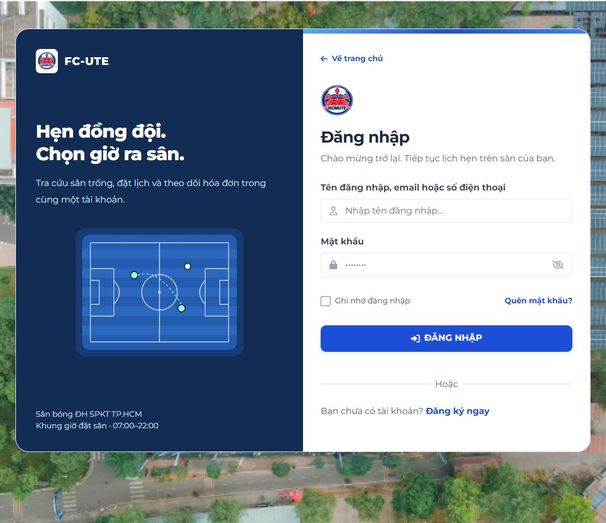

1. Khách mới có thể xem sân ở Trang chủ. Chọn Đăng ký khi cần tạo tài khoản khách hàng; nhập các trường bắt buộc và xác nhận thông tin trước khi gửi.
2. Chọn Đăng nhập, nhập email hoặc số điện thoại và mật khẩu. Có thể bấm biểu tượng con mắt để kiểm tra mật khẩu đã nhập.
3. Chỉ bật Ghi nhớ đăng nhập trên thiết bị cá nhân. Trên máy dùng chung, bỏ chọn mục này và luôn Đăng xuất sau khi sử dụng.
4. Sau khi đăng nhập thành công, hệ thống mở khu vực phù hợp với vai trò. Nhân viên, kế toán và chủ sân dùng tài khoản được người có quyền quản lý cấp.
5. Nếu quên mật khẩu, bấm Quên mật khẩu để xem hướng dẫn liên hệ 0373 855 657, hiển thị hỗ trợ 24/7. Cung cấp thông tin tài khoản để được xác minh; sau khi được cấp lại mật khẩu, đăng nhập và đổi mật khẩu mới.

**Lưu ý:** Không cung cấp mật khẩu hiện tại cho người hỗ trợ. Quên mật khẩu đang dùng hình thức liên hệ nhân viên, không gửi mã SMS hoặc email tự động.

## 2 Khách hàng đặt sân và dịch vụ

Menu Đặt sân

Đăng nhập bằng tài khoản khách hàng. Mỗi lượt đặt cần có ngày chơi, sân cụ thể và khoảng giờ còn trống.

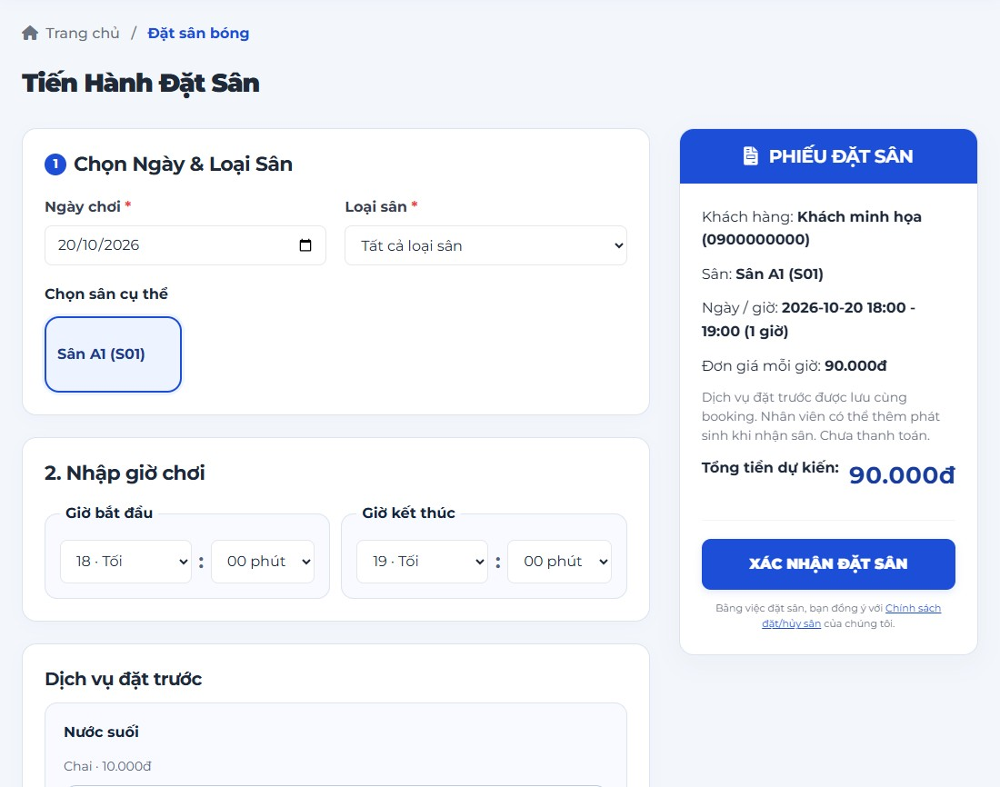

1. Vào Đặt sân. Chọn ngày chơi và loại sân; hệ thống tra cứu các sân phù hợp với khoảng giờ đã chọn.
2. Chọn giờ bắt đầu và giờ kết thúc bằng hai ô giờ và phút. Nhãn Sáng, Chiều, Tối đi kèm giờ 24 tiếng; ví dụ 18 giờ là 6 giờ tối. Khoảng giờ của lượt đặt mới nằm trong 07:00–22:00; giờ kết thúc phải sau giờ bắt đầu.
3. Bấm vào sân muốn đặt. Nếu không có sân khả dụng, đổi ngày hoặc khoảng giờ rồi tra cứu lại.
4. Ở Dịch vụ đặt trước, dùng dấu cộng hoặc trừ để thay đổi số lượng, hoặc nhập số nguyên không âm. Chọn riêng đơn vị và lốc nếu dịch vụ hỗ trợ; số lốc là số gói lốc, không phải số chai.
5. Kiểm tra Phiếu đặt sân bên cạnh: tên sân, ngày giờ và tổng dự kiến. Đọc Chính sách đặt/hủy sân rồi bấm Xác nhận đặt sân một lần. Chỉ tiếp tục khi hệ thống báo tạo thành công và có mã lượt đặt.

**Lưu ý:** Kết quả tra cứu chưa giữ chỗ. Nếu sân vừa được người khác đặt, hệ thống sẽ từ chối và yêu cầu chọn lại. Tạo lượt đặt chưa có nghĩa đã thanh toán.

## 3 Khách hàng xem lịch và thanh toán

Menu Lịch đặt của tôi và Khuyến mãi

Sau khi tạo thành công, mở chi tiết lượt đặt được chuyển đến hoặc vào Lịch đặt của tôi để tìm lại bằng ngày, sân và trạng thái.

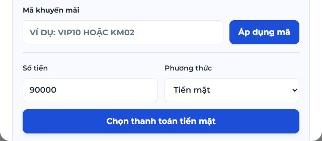

1. Mở Chi tiết của đúng lượt đặt. Kiểm tra mã đặt sân, thông tin sân, giờ chơi và số tiền; mã này dùng để trao đổi với nhân viên.
2. Nếu có ưu đãi, xem điều kiện tại Khuyến mãi. Nhập mã vào Mã khuyến mãi và bấm Áp dụng mã trước khi thanh toán; chỉ dùng mức giảm khi hệ thống xác nhận áp dụng thành công.
3. Chọn Tiền mặt để thanh toán tại sân. Việc bấm Chọn thanh toán tiền mặt là lựa chọn phương thức; khoản thu chỉ được ghi nhận khi nhân viên xác nhận thực nhận.
4. Nếu chọn Chuyển khoản, kiểm tra số tiền và thông tin người nhận hiện trên màn hình trước khi chuyển. Sau khi chuyển thực tế, bấm Tôi đã chuyển khoản để gửi yêu cầu xác minh. Không chuyển lặp lại khi yêu cầu đang chờ.
5. Mở lại chi tiết để xem trạng thái. Có thể dùng In phiếu đặt sân khi nút này xuất hiện, rồi chọn máy in hoặc Lưu PDF trong hộp thoại trình duyệt.

**Lưu ý:** Mã ưu đãi chỉ áp dụng khi đáp ứng điều kiện và còn được hệ thống cho phép. Phiếu đặt sân phục vụ tra cứu lượt đặt, không thay thế xác nhận đã nhận tiền.

## 4 Khách hàng quản lý lịch sử và tài khoản

Menu Lịch sử đặt sân và Thông tin tài khoản

Khách hàng chỉ xem và thao tác trên các lượt đặt thuộc tài khoản của mình. Menu và nút bấm phụ thuộc trạng thái lượt đặt và quyền được cấp.

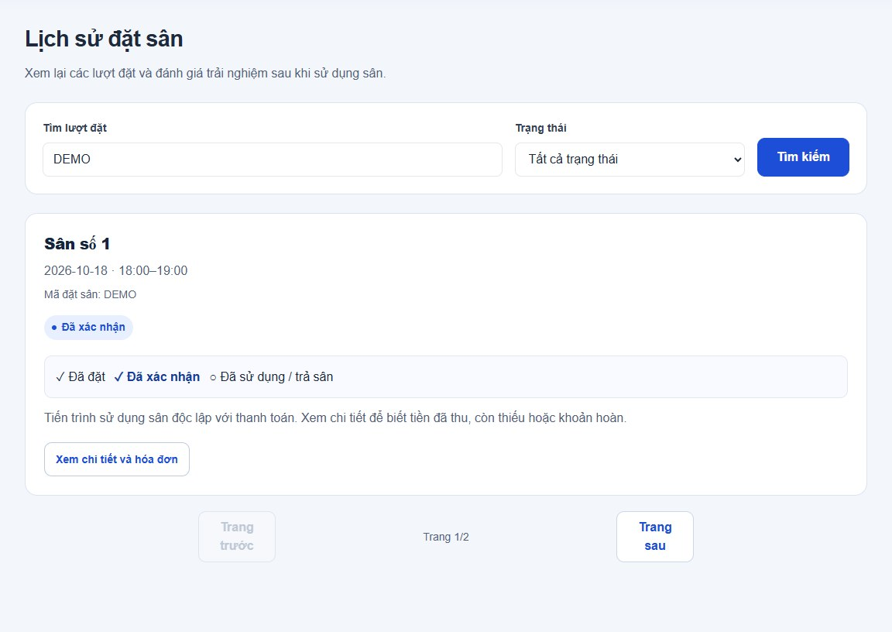

1. Vào Lịch sử đặt sân. Nhập mã lượt đặt hoặc tên sân, chọn trạng thái và bấm Tìm kiếm. Dùng Trước hoặc Sau để chuyển trang khi có nhiều kết quả.
2. Mở lượt đặt cần xem. Nếu hệ thống cho phép đánh giá sau khi sử dụng sân, nhập điểm và nội dung rồi gửi; kiểm tra thông báo lưu thành công.
3. Nếu cần hủy, mở chức năng Hủy của lượt đặt hợp lệ, đọc mức hoàn dự kiến, nhập lý do và xác nhận. Không coi tiền hoàn dự kiến là tiền đã nhận.
4. Vào Thông tin tài khoản để cập nhật thông tin liên hệ bằng biểu mẫu tương ứng. Khi chỉ cập nhật hồ sơ, không cần điền các ô đổi mật khẩu.
5. Nếu muốn đổi mật khẩu, dùng riêng biểu mẫu đổi mật khẩu: điền mật khẩu hiện tại, mật khẩu mới và xác nhận mật khẩu mới. Sau khi đổi thành công, đăng nhập lại. Gửi ý kiến trong biểu mẫu phản hồi nếu cần hỗ trợ thêm.

**Lưu ý:** Chính sách hủy đang áp dụng: trước giờ chơi từ 10 giờ trở lên hoàn 100% thực thu; từ 2 giờ đến dưới 10 giờ hoàn 50%; dưới 2 giờ hoàn 0%. Quyền hủy và số tiền cuối cùng do hệ thống kiểm tra.

## 5 Nhân viên theo dõi công việc và lịch sân

Menu Bảng điều khiển sân và Lịch đá bóng

Đăng nhập bằng tài khoản nhân viên sân. Bắt đầu tại Bảng điều khiển sân để xem các lượt cần xử lý trong ngày.

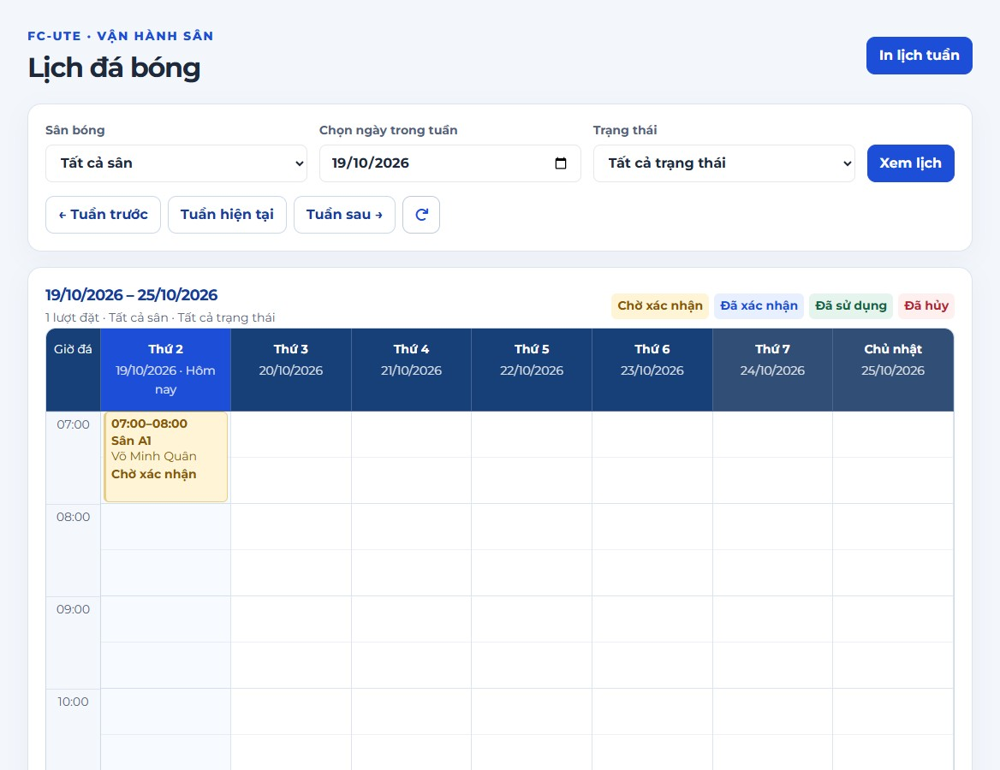

1. Xem Việc cần xử lý hôm nay; bấm lượt đặt để mở thông tin. Dùng nút mũi tên xoay vòng để tải lại khi cần cập nhật.
2. Vào Lịch đá bóng. Chọn sân, ngày trong tuần và trạng thái; bấm Xem lịch hoặc dùng bộ lọc để tải lịch phù hợp.
3. Dùng Tuần trước, Tuần hiện tại và Tuần sau để di chuyển. Cuộn bên trong bảng lịch khi cần xem giờ muộn hoặc các ngày ở bên phải.
4. Đọc thông tin trên ô lịch. Một ngày có thể có nhiều sân hoặc nhiều lượt cùng thời điểm; bấm đúng ô để mở lượt đặt cần xử lý.
5. Dùng In lịch tuần khi cần bản giấy. Để tìm kiếm và thao tác theo danh sách, mở Quản lý lượt đặt; lọc ngày, sân, khung giờ và trạng thái trước khi chọn hành động.

**Lưu ý:** Trạng thái lượt đặt và trạng thái sử dụng sân là hai thông tin khác nhau. Luôn kiểm tra mã lượt đặt, tên sân và ngày chơi trước khi xác nhận.

## 6 Nhân viên tạo phiếu tại quầy

Menu Đặt sân tại quầy

Dùng chức năng này khi nhân viên đặt sân giúp khách đến trực tiếp hoặc liên hệ tại quầy. Cần có quyền tạo lượt đặt.

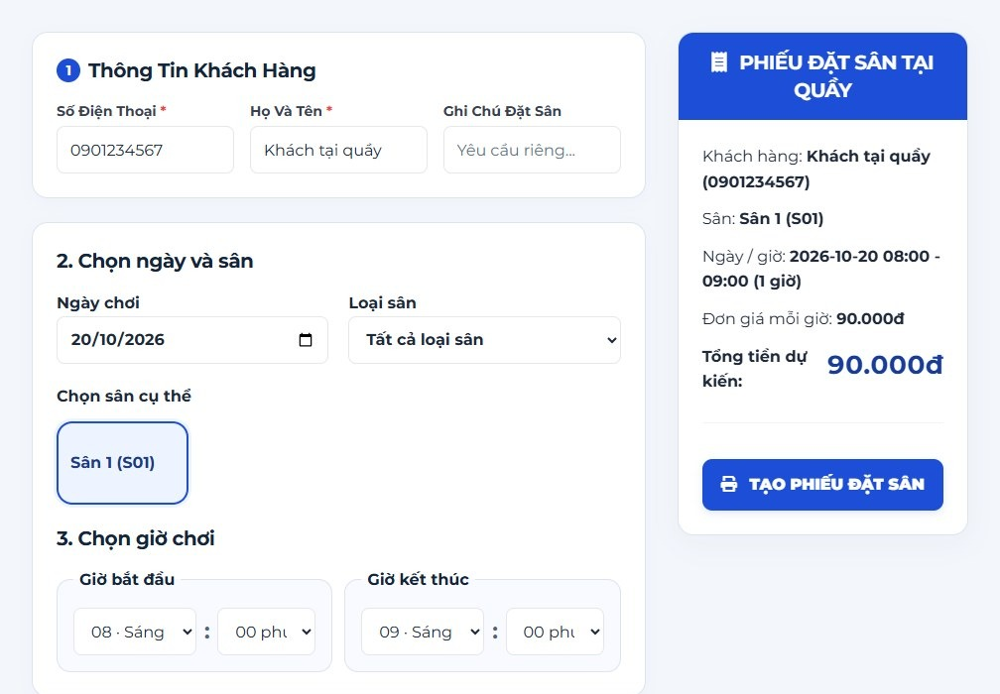

1. Vào Đặt sân tại quầy. Điền số điện thoại và họ tên khách; không cần bấm nút tra cứu riêng.
2. Chọn ngày chơi, loại sân và khoảng giờ. Chọn một sân còn trống từ kết quả tra cứu. Nếu không có sân phù hợp, trao đổi với khách để chọn khoảng khác.
3. Kiểm tra lại số điện thoại và họ tên. Hệ thống xử lý khách hàng khi tạo phiếu; nếu số điện thoại đã thuộc một khách khác tên, phải kiểm tra lại thông tin thay vì dùng nhầm hồ sơ.
4. Xem phiếu dự kiến, chọn dịch vụ đặt trước nếu màn hình có mục này và kiểm tra tổng tiền. Bấm nút tạo hoặc xác nhận phiếu một lần.
5. Khi tạo thành công, ghi lại mã lượt đặt và mở chi tiết để tiếp tục xác nhận, nhận sân hoặc thanh toán theo nghiệp vụ. Nếu hệ thống báo lỗi, sửa thông tin theo thông báo rồi gửi lại.

**Lưu ý:** Tạo phiếu tại quầy không tự xác nhận đã nhận tiền. Khi phản hồi bị gián đoạn, tìm lại lượt vừa tạo trước khi gửi thêm một phiếu mới.

## 7 Nhân viên nhận sân và ghi dịch vụ

Menu Quản lý lượt đặt

Tìm đúng lượt đặt rồi mở Nhận sân / Dịch vụ. Các nút được bật theo quyền, trạng thái và thời điểm cho phép.

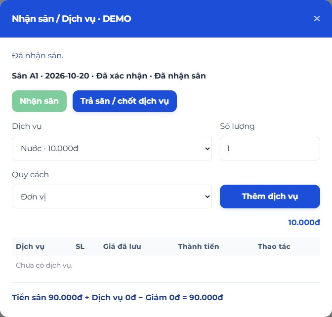

1. Với lượt Chờ xác nhận, kiểm tra thông tin rồi bấm Xác nhận. Nếu không thể tiếp nhận, xử lý hủy theo quyền và chính sách thay vì nhận sân cho lượt chưa xác nhận.
2. Khi khách đến và hệ thống cho phép, bấm Nhận sân. Kiểm tra thông tin đã nhận sân trước khi ghi dịch vụ phát sinh.
3. Chọn dịch vụ, quy cách đơn vị hoặc lốc và số lượng, rồi bấm Thêm dịch vụ. Kiểm tra dòng dịch vụ, đơn giá được lưu và thành tiền. Nếu cần sửa hoặc bỏ dòng, dùng thao tác hệ thống cho phép trên đúng dòng.
4. Khi khách chơi xong, kiểm tra toàn bộ dịch vụ rồi bấm Trả sân / chốt dịch vụ. Hệ thống ghi nhận thời điểm trả sân và chốt hóa đơn theo nghiệp vụ.
5. Mở Chi tiết để kiểm tra tiền còn thiếu sau các lần thu trước. Chỉ ghi nhận thu thêm khi đã nhận tiền thực tế; chuyển khoản cần được người có quyền xác minh.

**Lưu ý:** Ví dụ: khách đã trả 90.000đ tiền sân, phát sinh 20.000đ dịch vụ thì còn thu thêm 20.000đ nếu không có khoản giảm khác. Trả sân không tự ghi nhận khoản tiền mới.

## 8 Nhân viên cập nhật sân và phản hồi

Menu Trạng thái sân và Tiếp nhận phản hồi

Dùng trang trạng thái để xem tình hình sân hiện tại; dùng trang phản hồi để theo dõi các ý kiến khách đã gửi.

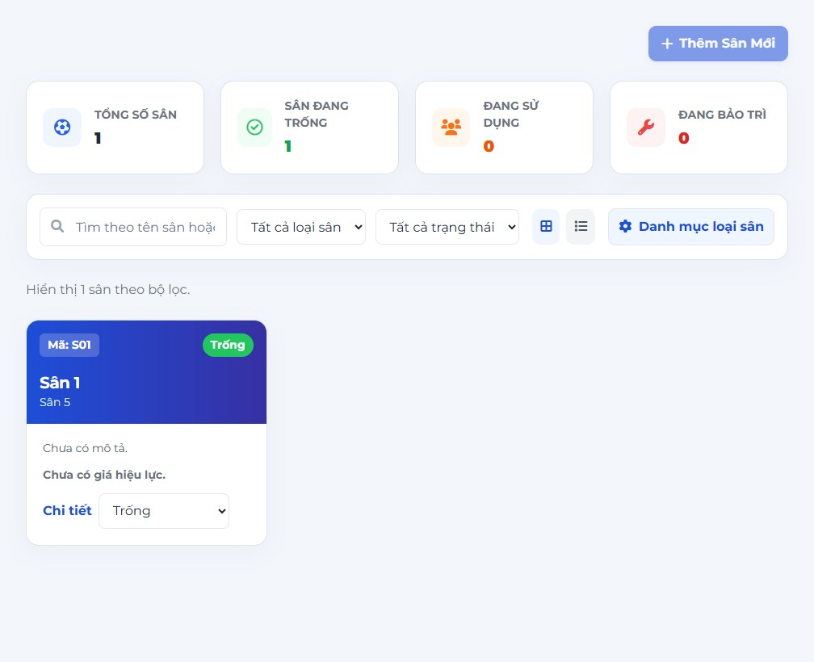

1. Vào Trạng thái sân. Xem các ô Tổng số sân, Sân đang trống, Đang sử dụng và Đang bảo trì; số tổng quan có thể khác số kết quả sau lọc.
2. Nhập tên hoặc mã sân, chọn loại sân hay trạng thái để tìm sân cần xử lý. Có thể đổi chế độ lưới hoặc danh sách nếu màn hình hỗ trợ.
3. Mở lựa chọn thao tác của đúng sân và chọn Trống, Đang sử dụng hoặc Bảo trì. Chờ thông báo thành công rồi kiểm tra trạng thái mới; hệ thống có thể từ chối thay đổi không hợp lệ.
4. Vào Tiếp nhận phản hồi. Đọc khách gửi, loại phản hồi, nội dung và mã lượt đặt đi kèm để xử lý đúng việc.
5. Khi có quyền sửa, chọn trạng thái xử lý và nhập kết quả giải quyết rồi lưu. Chỉ đánh dấu Đã xử lý sau khi đã giải quyết; kiểm tra nội dung lưu lại trên màn hình.

**Lưu ý:** Không dùng thay đổi trạng thái sân để thay thế thao tác Nhận sân hoặc Trả sân của một lượt đặt. Trạng thái Trống cũng chưa bảo đảm sân rảnh cho một ngày giờ khác.

## 9 Kế toán xác nhận thu và hoàn tiền

Menu Thu tiền & Hoàn tiền

Chỉ thao tác khi có quyền tài chính. Kiểm tra chứng từ thực tế trước khi xác nhận khoản thu hoặc tiền hoàn.

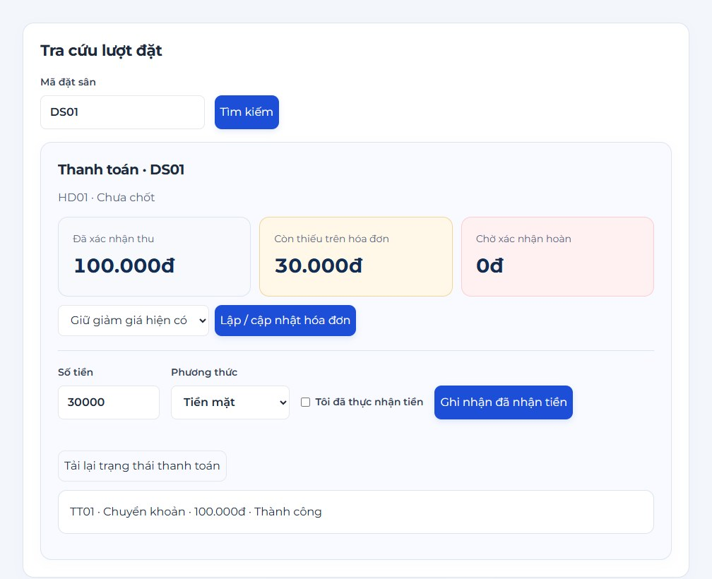

1. Nhập mã đặt sân tại Tra cứu lượt đặt và bấm Tìm kiếm. Kiểm tra hóa đơn, tổng tiền, đã thu, còn thiếu và các giao dịch trước đó.
2. Với yêu cầu thanh toán đang chờ, đối chiếu tiền mặt hoặc giao dịch ngân hàng thực nhận. Bấm Xác nhận đã nhận tiền trên đúng giao dịch khi đã kiểm chứng; không xác nhận chỉ dựa vào lời nhắn của khách.
3. Nếu trực tiếp ghi khoản thu mới, nhập số tiền, chọn phương thức, đánh dấu đã thực nhận khi biểu mẫu yêu cầu rồi bấm Ghi nhận đã nhận tiền. Chờ báo thành công và kiểm tra lại lịch sử.
4. Nếu khách dùng thêm dịch vụ, cập nhật hóa đơn theo quyền khi còn cho phép và chỉ thu phần còn thiếu. Ví dụ hóa đơn 130.000đ, đã thu 100.000đ thì còn 30.000đ; không ghi lại khoản 100.000đ.
5. Với yêu cầu hoàn đang chờ duyệt, kiểm tra lượt hủy và mức hoàn hệ thống tính. Hoàn tiền thực tế theo phương thức đã chọn, rồi dùng Xác nhận đã hoàn thực tế, nhập lý do theo yêu cầu và kiểm tra trạng thái.

**Lưu ý:** Giao dịch chờ xác minh chưa được tính là tiền đã thu. Khoản chờ hoàn chưa làm giảm thực nhận; ứng dụng chỉ ghi nhận nội bộ, không tự chuyển tiền ngân hàng.

## 10 Kế toán xem biểu đồ doanh thu

Menu Doanh thu

Trang Doanh thu dành cho kế toán và chủ sân có quyền xem báo cáo. Chọn chỉ tiêu cần xem để đọc đúng ý nghĩa số liệu.

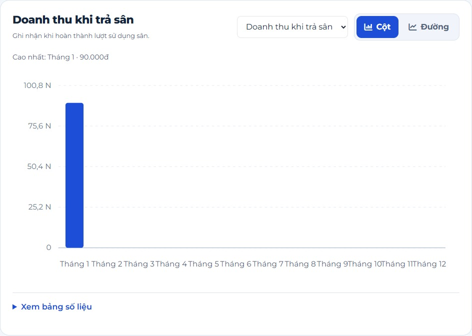

1. Chọn Tổng hợp theo Ngày, Tuần, Tháng hoặc Năm. Nhập năm và chọn sân cụ thể hoặc Tất cả sân.
2. Với Ngày, chọn thêm tháng để xem từng ngày trong tháng đó. Với Tuần, xem các tuần thuộc năm đã chọn; tuần bắt đầu từ thứ Hai, tuần đầu hoặc cuối chỉ tính các ngày nằm trong năm.
3. Với Tháng, xem 12 tháng của năm đã chọn. Với Năm, xem tối đa 5 năm liên tiếp kết thúc tại năm đã chọn. Bấm Xem doanh thu để tải số liệu theo bộ lọc.
4. Chọn chỉ tiêu Doanh thu khi trả sân, Tiền đã thu, Tiền đã hoàn hoặc Thực nhận. Bấm Cột hay Đường để đổi kiểu biểu đồ mà vẫn giữ kỳ và dữ liệu đang xem.
5. Đọc các ô tổng hợp, xem gợi ý khi trỏ vào điểm hoặc cột và mở Xem bảng số liệu để kiểm tra từng kỳ. Dùng mũi tên xoay vòng để tải lại khi có giao dịch mới.

**Lưu ý:** Doanh thu được ghi nhận theo ngày trả sân. Tiền đã thu tính theo ngày xác nhận nhận tiền; Thực nhận bằng tiền đã thu trừ tiền đã hoàn. Không cộng các chỉ tiêu này thành một tổng doanh thu.

## 11 Kế toán đối soát và xuất báo cáo

Menu Đối soát & Báo cáo

Đối soát giúp kiểm tra từng lượt đặt; báo cáo tổng hợp giúp theo dõi tiền thu, tiền hoàn và doanh thu trong khoảng ngày.

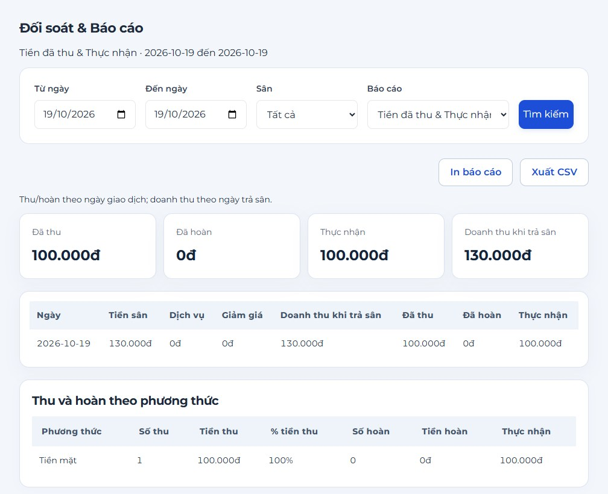

1. Vào Đối soát & Báo cáo. Chọn loại Đối soát lượt đặt, khoảng từ ngày đến ngày và sân cần kiểm tra; bấm nút xem báo cáo.
2. Đọc từng dòng đối soát: mã lượt đặt, hóa đơn, tiền thu, tiền hoàn, khoản chờ và các cột sai lệch. Nếu có vấn đề, mở lại lượt đặt hoặc giao dịch để kiểm tra nguyên nhân.
3. Chọn Tiền đã thu & Thực nhận để xem số tổng theo ngày và cơ cấu phương thức thanh toán. Chọn Báo cáo hoàn tiền khi cần kiểm tra các khoản hoàn.
4. Đổi bộ lọc rồi tải lại trước khi in hoặc xuất CSV. File xuất chỉ phản ánh loại báo cáo và khoảng dữ liệu được chọn; kiểm tra tiêu đề cùng ngày báo cáo trước khi sử dụng.
5. Nếu báo lỗi khoảng ngày, thu hẹp phạm vi theo hướng dẫn hệ thống. Với báo cáo theo bảng hiện tại, khoảng ngày tối đa là 366 ngày; muốn so sánh nhiều năm hãy dùng trang Doanh thu.

**Lưu ý:** Đối soát là bước kiểm tra số liệu, không tự sửa giao dịch hoặc tự chuyển khoản. Nếu phản hồi tải lỗi, tải lại trước khi kết luận không có phát sinh.

## 12 Chủ sân quản lý nhân sự và quyền

Menu Tổng quan và Nhân sự & Phân quyền

Chủ sân dùng Tổng quan để xem hoạt động trong ngày, sau đó mở các mục quản trị theo quyền được cấp.

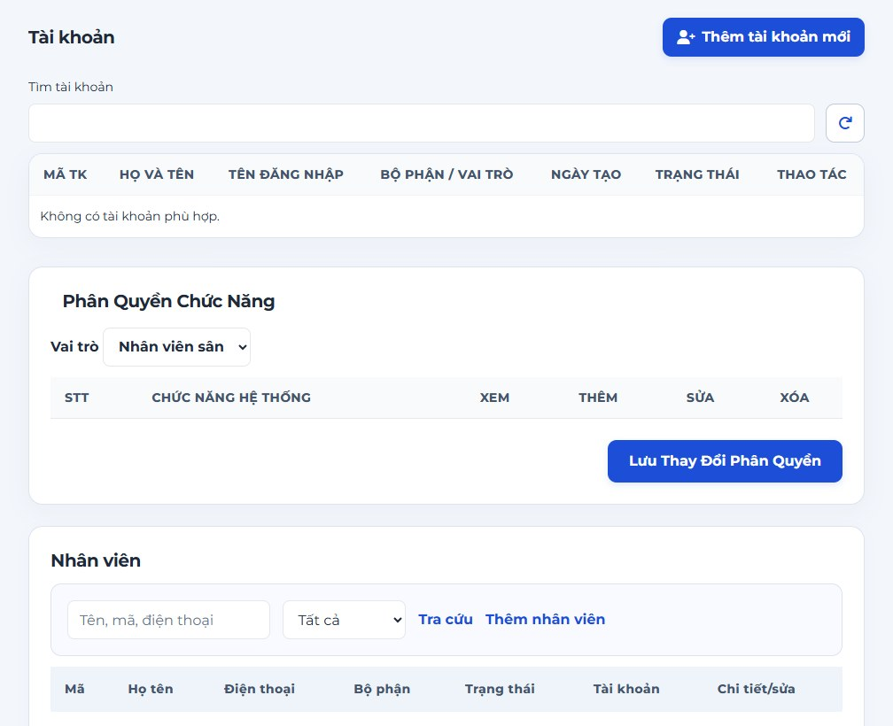

1. Tại Tổng quan, xem số lượt đặt, sân đang dùng, sân bảo trì và các chỉ tiêu tiền. Bấm ô số liệu hoặc lượt đặt để mở trang chi tiết tương ứng.
2. Vào Nhân sự & Phân quyền. Tìm nhân viên theo bộ lọc; thêm nhân viên bằng biểu mẫu và điền các trường bắt buộc. Kiểm tra thông báo sau khi lưu.
3. Ở phần tài khoản, tạo tài khoản gắn với nhân viên phù hợp, chọn vai trò và trạng thái. Không chia sẻ một tài khoản giữa nhiều người khi cần theo dõi trách nhiệm thao tác.
4. Khi sửa vai trò, quyền hoặc trạng thái, đọc lại thông tin trước khi lưu. Chỉ cấp quyền đúng nhiệm vụ; không coi việc thấy một menu là bằng chứng đã có mọi quyền sửa trong trang.
5. Nếu cần đặt lại mật khẩu, xác minh người yêu cầu rồi dùng chức năng reset của tài khoản theo quyền. Hướng dẫn người dùng đổi mật khẩu sau khi đăng nhập. Xem Nhật ký để tra cứu thời gian, tài khoản và hành động đã ghi.

**Lưu ý:** Khóa hoặc ngừng tài khoản không xóa lịch sử nghiệp vụ. Không ghi mật khẩu vào nhật ký, báo cáo hay ảnh minh họa; kiểm tra lại phiên đăng nhập sau thay đổi quản trị.

## 13 Chủ sân cấu hình kinh doanh

Menu Cấu hình kinh doanh

Trang cấu hình tập trung danh mục và các tham số kinh doanh. Mỗi lần thay đổi cần kiểm tra đúng nhóm dữ liệu và thời gian áp dụng.

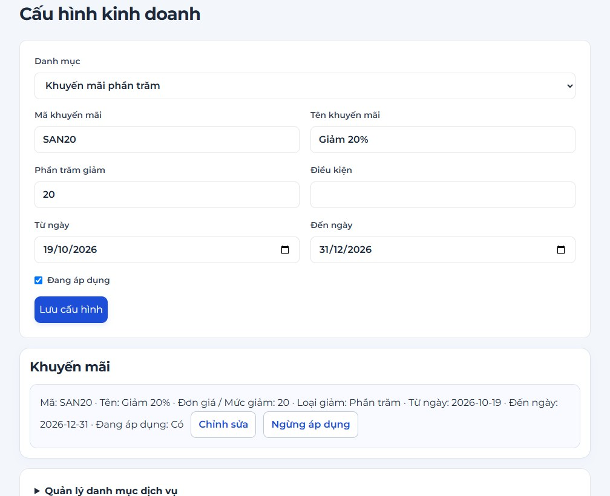

1. Vào Cấu hình kinh doanh. Chọn nhóm cần xem như loại sân, giá, khung giờ hoặc khuyến mãi; màn hình hiển thị nội dung của nhóm đang chọn.
2. Bấm Chỉnh sửa trên đúng dòng hoặc mở biểu mẫu thêm nếu được cấp quyền. Kiểm tra mã, tên và các trường bắt buộc trước khi lưu.
3. Với giá hoặc ưu đãi, nhập đúng mức giá, kiểu giảm, thời hạn và điều kiện hệ thống hỗ trợ. Dùng dữ liệu hợp lệ; không tự sửa trực tiếp số tiền của lượt đặt cũ.
4. Mở phần danh mục dịch vụ khi cần quản lý tên, đơn vị, đơn giá và quy cách lốc. Kiểm tra giá lốc và trạng thái sử dụng trước khi lưu.
5. Sau thay đổi, tải lại để kiểm tra dữ liệu. Nếu mục đã được sử dụng và không thể xóa, dùng trạng thái ngừng theo chức năng cho phép để giữ lịch sử.

**Lưu ý:** Giá và ưu đãi đã lưu trong các lượt đặt, dòng dịch vụ và hóa đơn cũ được bảo toàn theo nghiệp vụ. Sửa danh mục không có nghĩa tự tính lại toàn bộ lịch sử.

## 14 Sao lưu và xử lý tình huống thường gặp

Menu Sao lưu / Phục hồi và hỗ trợ sử dụng

Sao lưu tạo bản dữ liệu để phục hồi khi cần. Trang web hiện cung cấp hướng dẫn; quản trị vận hành thực hiện công việc trên máy SQL Server.

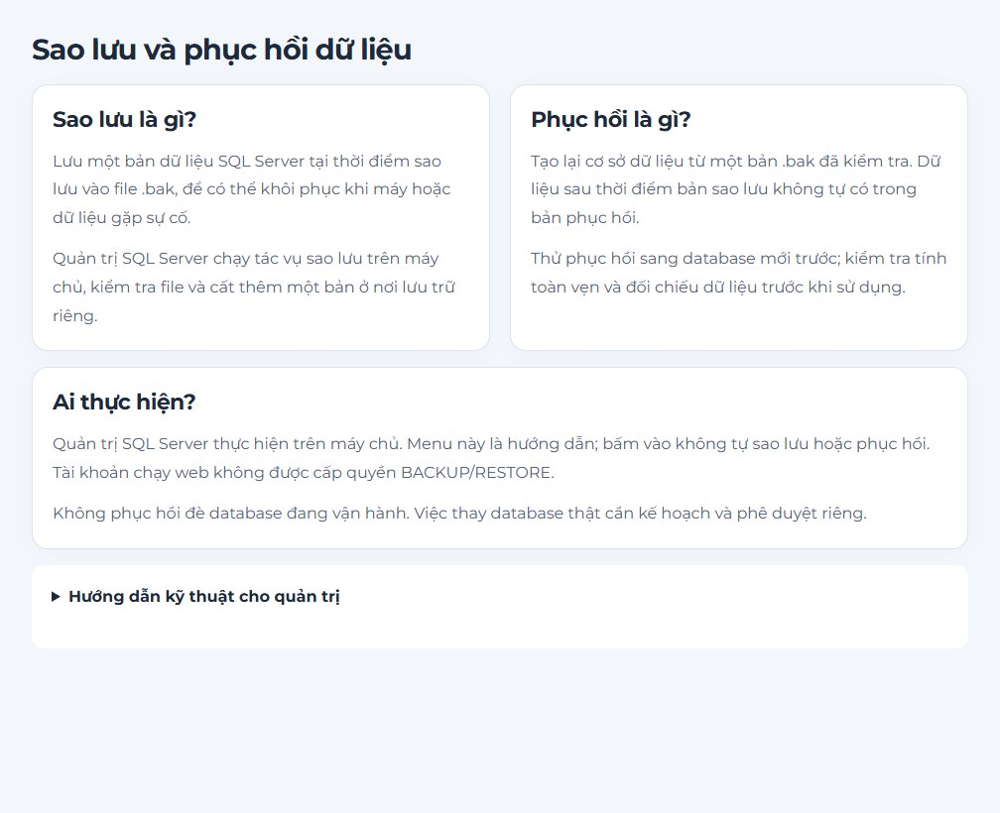

1. Vào Sao lưu / Phục hồi để đọc quy trình. Người có thẩm quyền tạo bản .bak và lưu tại nơi được kiểm soát; ghi nhận thời điểm, nơi lưu và kết quả kiểm tra.
2. Khi cần thử phục hồi, dùng một database mới theo hướng dẫn kỹ thuật. Không phục hồi đè database đang sử dụng chỉ để minh họa đồ án; việc đó có thể làm mất các phát sinh sau mốc sao lưu.
3. Không mở được web: kiểm tra địa chỉ và nhờ người quản lý kiểm tra server. Đường dẫn localhost chỉ hoạt động trên máy chạy ứng dụng; chưa phải địa chỉ dùng chung cho thiết bị khác.
4. Không thấy menu hoặc nút bị khóa: kiểm tra tài khoản, vai trò, quyền và trạng thái lượt đặt. Không đổi vai trò tùy ý hoặc bỏ qua kiểm tra của hệ thống.
5. Báo lỗi sau khi bấm lưu hoặc thu tiền: đọc thông báo, tra cứu lại dữ liệu và lịch sử trước khi gửi lại. Chỉ thông báo hoàn tất khi có phản hồi thành công và dữ liệu khớp; cần hỗ trợ tài khoản thì dùng hướng dẫn Quên mật khẩu.

**Lưu ý:** Tài liệu này hướng dẫn thao tác sử dụng. Hướng dẫn cài đặt, vận hành và phục hồi kỹ thuật nằm trong README cùng các tài liệu triển khai, sao lưu của dự án.
